# Profil dan calon anomali seri utama

Dihasilkan `python pipeline.py` (`src/silver/profil.py`). Hanya baris provinsi deret utama (rincian `total`, atau rincian yang didaftar di `DERET` untuk seri yang terbit per rincian; label `kode [rincian]`); baris Indonesia ditampilkan terpisah dan tidak ikut statistik antarprovinsi.

## Banyak periode per provinsi (menentukan arah pembanding)

| seri_kode | min_periode_per_provinsi | maks_periode_per_provinsi |
|---|---|---|
| var1429 | 2 | 11 |
| var1443 | 2 | 11 |
| var2685 [umur=15-64] | 1 | 3 |
| var303 [jenjang=sd] | 2 | 23 |
| var303 [jenjang=sm] | 2 | 23 |
| var303 [jenjang=smp] | 2 | 23 |
| var417 | 2 | 16 |

- var1429: tiga arah (periode per provinsi 2–11)
- var1443: tiga arah (periode per provinsi 2–11)
- var2685 [umur=15-64]: hanya arah ke bawah dan perubahan (periode per provinsi 1–3)
- var303 [jenjang=sd]: tiga arah (periode per provinsi 2–23)
- var303 [jenjang=sm]: tiga arah (periode per provinsi 2–23)
- var303 [jenjang=smp]: tiga arah (periode per provinsi 2–23)
- var417: tiga arah (periode per provinsi 2–16)

Metode: IQR dengan pengali 1.5; arah ke samping hanya bila satu provinsi punya paling sedikit 6 periode. Sel yang ditandai lebih dari satu arah ditulis satu baris. Provinsi yang di luar batas ke bawah pada ≥ 50% periode diberi tanda `berulang`: itu perbedaan struktural antarprovinsi, bukan kejadian satu tahun. Lihat log untuk alasan memilih IQR.

## Statistik deskriptif per seri per periode (provinsi)

| seri_kode | periode | n | rerata | simpangan | minimum | q1 | median | q3 | maksimum |
|---|---|---|---|---|---|---|---|---|---|
| var1429 | 2015 | 34 | 8.52 | 0.91 | 6.27 | 7.88 | 8.55 | 9.12 | 10.90 |
| var1429 | 2016 | 34 | 8.64 | 0.88 | 6.48 | 8.05 | 8.68 | 9.23 | 10.92 |
| var1429 | 2017 | 34 | 8.72 | 0.87 | 6.58 | 8.14 | 8.75 | 9.32 | 10.97 |
| var1429 | 2018 | 34 | 8.79 | 0.87 | 6.66 | 8.25 | 8.84 | 9.39 | 11.06 |
| var1429 | 2019 | 34 | 8.96 | 0.84 | 6.85 | 8.35 | 9.03 | 9.53 | 11.11 |
| var1429 | 2020 | 34 | 9.08 | 0.83 | 6.96 | 8.50 | 9.14 | 9.65 | 11.17 |
| var1429 | 2021 | 34 | 9.16 | 0.83 | 7.05 | 8.54 | 9.22 | 9.71 | 11.20 |
| var1429 | 2022 | 34 | 9.25 | 0.82 | 7.31 | 8.58 | 9.22 | 9.78 | 11.30 |
| var1429 | 2023 | 34 | 9.30 | 0.82 | 7.34 | 8.68 | 9.29 | 9.85 | 11.42 |
| var1429 | 2024 | 38 | 9.29 | 1.15 | 5.10 | 8.79 | 9.34 | 9.93 | 11.49 |
| var1429 | 2025 | 38 | 9.46 | 1.19 | 4.76 | 8.93 | 9.57 | 10.09 | 11.58 |
| var1443 | 2015 | 34 | 28.40 | 10.60 | 11.13 | 21.18 | 26.31 | 32.80 | 64.83 |
| var1443 | 2016 | 34 | 30.74 | 10.23 | 14.48 | 24.01 | 28.98 | 34.87 | 65.51 |
| var1443 | 2017 | 34 | 33.20 | 10.77 | 15.01 | 25.64 | 31.57 | 38.88 | 70.10 |
| var1443 | 2018 | 34 | 33.32 | 10.65 | 13.20 | 26.27 | 33.59 | 37.91 | 70.60 |
| var1443 | 2019 | 34 | 33.59 | 10.75 | 14.27 | 25.48 | 32.03 | 38.42 | 73.14 |
| var1443 | 2020 | 34 | 34.14 | 10.86 | 14.73 | 26.48 | 32.25 | 39.28 | 74.69 |
| var1443 | 2021 | 34 | 34.39 | 10.68 | 15.23 | 26.74 | 32.89 | 40.09 | 74.90 |
| var1443 | 2022 | 34 | 34.40 | 10.98 | 14.85 | 26.81 | 32.58 | 39.54 | 75.59 |
| var1443 | 2023 | 34 | 34.53 | 10.22 | 18.19 | 27.47 | 32.83 | 39.96 | 74.08 |
| var1443 | 2024 | 38 | 33.60 | 10.41 | 12.23 | 27.50 | 32.14 | 39.56 | 73.90 |
| var1443 | 2025 | 38 | 33.56 | 10.18 | 13.34 | 28.02 | 33.55 | 39.05 | 74.70 |
| var2685 [umur=15-64] | 2022 | 34 | 15.11 | 1.90 | 10.94 | 13.63 | 14.89 | 16.16 | 20.08 |
| var2685 [umur=15-64] | 2023 | 34 | 14.80 | 2.10 | 8.08 | 13.31 | 14.76 | 16.11 | 18.41 |
| var2685 [umur=15-64] | 2024 | 38 | 15.06 | 2.78 | 5.65 | 14.00 | 15.34 | 16.64 | 19.53 |
| var303 [jenjang=sd] | 2003 | 30 | 106.19 | 3.36 | 97.60 | 105.05 | 106.50 | 107.60 | 114.40 |
| var303 [jenjang=sd] | 2004 | 30 | 107.83 | 2.66 | 102.41 | 106.37 | 107.91 | 109.33 | 113.52 |
| var303 [jenjang=sd] | 2005 | 30 | 107.12 | 2.81 | 99.51 | 105.61 | 107.09 | 108.73 | 111.71 |
| var303 [jenjang=sd] | 2006 | 33 | 110.82 | 3.29 | 98.83 | 109.25 | 111.33 | 113.11 | 116.06 |
| var303 [jenjang=sd] | 2007 | 33 | 113.28 | 3.57 | 102.69 | 111.09 | 112.73 | 115.39 | 121.31 |
| var303 [jenjang=sd] | 2008 | 33 | 112.57 | 3.38 | 101.14 | 111.08 | 112.50 | 114.38 | 119.27 |
| var303 [jenjang=sd] | 2009 | 33 | 111.39 | 4.46 | 91.28 | 110.31 | 112.21 | 113.79 | 117.50 |
| var303 [jenjang=sd] | 2010 | 33 | 112.36 | 4.33 | 93.27 | 110.63 | 112.83 | 115.06 | 118.13 |
| var303 [jenjang=sd] | 2011 | 33 | 103.18 | 4.16 | 84.06 | 102.40 | 103.74 | 104.76 | 110.90 |
| var303 [jenjang=sd] | 2012 | 33 | 105.06 | 4.71 | 84.32 | 103.57 | 106.12 | 107.60 | 112.29 |
| var303 [jenjang=sd] | 2013 | 33 | 107.91 | 4.56 | 85.95 | 107.14 | 108.85 | 110.22 | 113.44 |
| var303 [jenjang=sd] | 2014 | 33 | 109.53 | 4.21 | 90.67 | 108.99 | 110.32 | 111.88 | 114.68 |
| var303 [jenjang=sd] | 2015 | 34 | 110.60 | 4.36 | 95.15 | 108.84 | 111.44 | 113.33 | 116.46 |
| var303 [jenjang=sd] | 2016 | 34 | 109.55 | 3.84 | 94.74 | 108.21 | 110.15 | 111.59 | 114.33 |
| var303 [jenjang=sd] | 2017 | 34 | 109.04 | 4.07 | 92.94 | 107.67 | 109.70 | 111.88 | 115.05 |
| var303 [jenjang=sd] | 2018 | 34 | 109.29 | 4.32 | 94.47 | 107.02 | 110.06 | 111.75 | 116.97 |
| var303 [jenjang=sd] | 2019 | 34 | 107.99 | 4.00 | 91.94 | 106.82 | 108.45 | 109.97 | 114.95 |
| var303 [jenjang=sd] | 2020 | 34 | 106.82 | 3.81 | 91.27 | 105.90 | 107.13 | 108.71 | 113.40 |
| var303 [jenjang=sd] | 2021 | 34 | 106.69 | 3.66 | 93.07 | 105.18 | 107.03 | 108.38 | 113.55 |
| var303 [jenjang=sd] | 2022 | 34 | 106.81 | 3.50 | 94.26 | 105.36 | 107.03 | 108.48 | 113.36 |
| var303 [jenjang=sd] | 2023 | 34 | 106.08 | 3.50 | 91.10 | 104.65 | 106.75 | 108.18 | 111.35 |
| var303 [jenjang=sd] | 2024 | 38 | 104.46 | 6.82 | 74.02 | 103.90 | 105.89 | 107.39 | 110.58 |
| var303 [jenjang=sd] | 2025 | 38 | 105.47 | 5.81 | 82.52 | 104.72 | 106.61 | 107.89 | 111.22 |
| var303 [jenjang=sm] | 2003 | 30 | 51.91 | 12.21 | 33.60 | 42.85 | 48.10 | 61.20 | 77.50 |
| var303 [jenjang=sm] | 2004 | 30 | 55.82 | 12.14 | 37.92 | 47.53 | 52.08 | 66.75 | 77.63 |
| var303 [jenjang=sm] | 2005 | 30 | 57.32 | 10.41 | 38.33 | 49.45 | 55.79 | 67.44 | 78.05 |
| var303 [jenjang=sm] | 2006 | 33 | 57.82 | 9.37 | 43.76 | 50.84 | 54.87 | 67.53 | 73.70 |
| var303 [jenjang=sm] | 2007 | 33 | 62.02 | 10.43 | 45.29 | 54.90 | 59.27 | 70.47 | 81.81 |
| var303 [jenjang=sm] | 2008 | 33 | 61.31 | 9.68 | 44.58 | 53.37 | 59.86 | 69.55 | 79.04 |
| var303 [jenjang=sm] | 2009 | 33 | 65.22 | 10.13 | 51.75 | 58.56 | 62.04 | 72.46 | 89.87 |
| var303 [jenjang=sm] | 2010 | 33 | 66.16 | 9.58 | 48.20 | 58.95 | 63.21 | 72.82 | 86.92 |
| var303 [jenjang=sm] | 2011 | 33 | 68.03 | 9.88 | 46.29 | 61.34 | 67.35 | 73.55 | 87.49 |
| var303 [jenjang=sm] | 2012 | 33 | 69.77 | 9.31 | 44.23 | 64.90 | 68.73 | 74.87 | 86.83 |
| var303 [jenjang=sm] | 2013 | 33 | 70.60 | 8.69 | 53.48 | 63.81 | 71.00 | 77.15 | 90.04 |
| var303 [jenjang=sm] | 2014 | 33 | 77.25 | 7.02 | 61.53 | 72.51 | 76.68 | 82.96 | 94.62 |
| var303 [jenjang=sm] | 2015 | 34 | 80.88 | 6.89 | 66.97 | 76.13 | 82.02 | 84.89 | 95.13 |
| var303 [jenjang=sm] | 2016 | 34 | 83.55 | 6.70 | 66.85 | 79.59 | 83.61 | 88.37 | 95.38 |
| var303 [jenjang=sm] | 2017 | 34 | 85.11 | 6.58 | 67.94 | 80.51 | 84.60 | 89.70 | 99.51 |
| var303 [jenjang=sm] | 2018 | 34 | 82.79 | 6.45 | 65.07 | 78.98 | 83.92 | 87.36 | 96.08 |
| var303 [jenjang=sm] | 2019 | 34 | 86.49 | 6.14 | 72.92 | 82.90 | 86.72 | 89.84 | 97.91 |
| var303 [jenjang=sm] | 2020 | 34 | 87.08 | 6.10 | 73.35 | 84.40 | 86.99 | 90.68 | 98.31 |
| var303 [jenjang=sm] | 2021 | 34 | 87.70 | 6.03 | 75.05 | 84.66 | 87.68 | 92.10 | 97.25 |
| var303 [jenjang=sm] | 2022 | 34 | 87.82 | 6.01 | 75.49 | 84.81 | 87.39 | 92.10 | 97.71 |
| var303 [jenjang=sm] | 2023 | 34 | 88.72 | 6.17 | 73.90 | 85.73 | 89.12 | 93.36 | 98.02 |
| var303 [jenjang=sm] | 2024 | 38 | 88.22 | 8.94 | 53.66 | 86.08 | 89.37 | 94.03 | 98.75 |
| var303 [jenjang=sm] | 2025 | 38 | 88.83 | 9.39 | 54.52 | 87.04 | 90.14 | 93.39 | 99.59 |
| var303 [jenjang=smp] | 2003 | 30 | 80.36 | 10.16 | 56.80 | 75.12 | 80.75 | 87.15 | 100.60 |
| var303 [jenjang=smp] | 2004 | 30 | 82.34 | 8.90 | 63.43 | 77.49 | 83.80 | 88.60 | 97.29 |
| var303 [jenjang=smp] | 2005 | 30 | 82.53 | 9.04 | 61.78 | 76.17 | 84.29 | 88.66 | 98.21 |
| var303 [jenjang=smp] | 2006 | 33 | 82.06 | 8.07 | 65.39 | 77.48 | 83.41 | 86.19 | 96.96 |
| var303 [jenjang=smp] | 2007 | 33 | 84.67 | 8.01 | 69.94 | 77.99 | 84.87 | 90.13 | 102.35 |
| var303 [jenjang=smp] | 2008 | 33 | 85.17 | 9.45 | 66.57 | 79.70 | 85.84 | 90.06 | 107.53 |
| var303 [jenjang=smp] | 2009 | 33 | 79.71 | 7.83 | 58.35 | 76.54 | 80.78 | 84.53 | 92.47 |
| var303 [jenjang=smp] | 2010 | 33 | 79.18 | 8.17 | 60.05 | 74.46 | 80.34 | 85.07 | 93.47 |
| var303 [jenjang=smp] | 2011 | 33 | 89.04 | 5.91 | 67.39 | 87.69 | 90.08 | 92.46 | 97.59 |
| var303 [jenjang=smp] | 2012 | 33 | 88.19 | 5.89 | 71.71 | 84.55 | 88.59 | 93.30 | 96.47 |
| var303 [jenjang=smp] | 2013 | 33 | 83.95 | 6.60 | 65.01 | 80.85 | 85.46 | 87.77 | 94.39 |
| var303 [jenjang=smp] | 2014 | 33 | 87.45 | 5.06 | 71.02 | 85.97 | 88.23 | 90.66 | 95.99 |
| var303 [jenjang=smp] | 2015 | 34 | 90.74 | 5.92 | 73.59 | 88.46 | 91.09 | 94.08 | 100.83 |
| var303 [jenjang=smp] | 2016 | 34 | 89.47 | 5.28 | 72.07 | 87.16 | 90.39 | 92.52 | 99.15 |
| var303 [jenjang=smp] | 2017 | 34 | 89.85 | 4.51 | 81.20 | 87.11 | 90.63 | 92.13 | 98.74 |
| var303 [jenjang=smp] | 2018 | 34 | 90.99 | 4.92 | 80.17 | 87.61 | 91.41 | 94.18 | 102.95 |
| var303 [jenjang=smp] | 2019 | 34 | 89.33 | 4.79 | 78.11 | 86.64 | 90.39 | 91.68 | 98.25 |
| var303 [jenjang=smp] | 2020 | 34 | 90.87 | 4.56 | 79.25 | 88.41 | 91.50 | 93.10 | 101.47 |
| var303 [jenjang=smp] | 2021 | 34 | 91.26 | 4.62 | 79.37 | 88.57 | 91.72 | 93.93 | 100.90 |
| var303 [jenjang=smp] | 2022 | 34 | 90.44 | 4.21 | 79.37 | 87.85 | 90.38 | 93.41 | 99.85 |
| var303 [jenjang=smp] | 2023 | 34 | 90.81 | 4.33 | 79.66 | 88.18 | 91.76 | 93.26 | 98.18 |
| var303 [jenjang=smp] | 2024 | 38 | 90.34 | 5.46 | 76.56 | 88.39 | 91.32 | 93.19 | 100.21 |
| var303 [jenjang=smp] | 2025 | 38 | 91.54 | 5.46 | 71.89 | 89.31 | 92.64 | 94.73 | 102.68 |
| var417 | 2010 | 33 | 11.41 | 0.89 | 8.57 | 11.02 | 11.34 | 11.76 | 14.15 |
| var417 | 2011 | 33 | 11.66 | 0.89 | 8.92 | 11.21 | 11.62 | 11.91 | 14.61 |
| var417 | 2012 | 33 | 11.87 | 0.87 | 9.11 | 11.42 | 11.79 | 12.20 | 14.64 |
| var417 | 2013 | 34 | 12.20 | 0.82 | 9.58 | 11.83 | 12.25 | 12.46 | 14.67 |
| var417 | 2014 | 34 | 12.46 | 0.80 | 9.94 | 12.10 | 12.47 | 12.73 | 14.85 |
| var417 | 2015 | 34 | 12.66 | 0.79 | 9.95 | 12.25 | 12.63 | 13.03 | 15.03 |
| var417 | 2016 | 34 | 12.82 | 0.79 | 10.23 | 12.36 | 12.79 | 13.16 | 15.23 |
| var417 | 2017 | 34 | 12.97 | 0.79 | 10.54 | 12.48 | 12.94 | 13.34 | 15.42 |
| var417 | 2018 | 34 | 13.04 | 0.78 | 10.83 | 12.59 | 12.99 | 13.44 | 15.56 |
| var417 | 2019 | 34 | 13.08 | 0.76 | 11.05 | 12.64 | 13.02 | 13.45 | 15.58 |
| var417 | 2020 | 34 | 13.14 | 0.75 | 11.08 | 12.72 | 13.03 | 13.57 | 15.59 |
| var417 | 2021 | 34 | 13.21 | 0.74 | 11.11 | 12.82 | 13.12 | 13.63 | 15.64 |
| var417 | 2022 | 34 | 13.24 | 0.74 | 11.14 | 12.83 | 13.16 | 13.64 | 15.65 |
| var417 | 2023 | 34 | 13.30 | 0.74 | 11.15 | 12.87 | 13.26 | 13.67 | 15.66 |
| var417 | 2024 | 38 | 13.21 | 1.02 | 9.63 | 12.86 | 13.25 | 13.72 | 15.70 |
| var417 | 2025 | 38 | 13.26 | 1.03 | 9.64 | 12.99 | 13.34 | 13.76 | 15.78 |

## Baris Indonesia

| seri_kode | periode | nilai | rujukan_tahun |
|---|---|---|---|
| var303 [jenjang=sd] | 2003 | 105.80 | <NA> |
| var303 [jenjang=sd] | 2004 | 107.13 | <NA> |
| var303 [jenjang=sd] | 2005 | 106.63 | <NA> |
| var303 [jenjang=sd] | 2006 | 109.96 | <NA> |
| var303 [jenjang=sd] | 2007 | 112.19 | <NA> |
| var303 [jenjang=sd] | 2008 | 111.12 | <NA> |
| var303 [jenjang=sd] | 2009 | 110.42 | <NA> |
| var303 [jenjang=sd] | 2010 | 111.68 | <NA> |
| var303 [jenjang=sd] | 2011 | 102.57 | <NA> |
| var303 [jenjang=sd] | 2012 | 104.33 | <NA> |
| var303 [jenjang=sd] | 2013 | 107.71 | <NA> |
| var303 [jenjang=sd] | 2014 | 108.87 | <NA> |
| var303 [jenjang=sd] | 2015 | 110.50 | <NA> |
| var303 [jenjang=sd] | 2016 | 109.31 | <NA> |
| var303 [jenjang=sd] | 2017 | 108.50 | <NA> |
| var303 [jenjang=sd] | 2018 | 108.61 | <NA> |
| var303 [jenjang=sd] | 2019 | 107.46 | <NA> |
| var303 [jenjang=sd] | 2020 | 106.32 | <NA> |
| var303 [jenjang=sd] | 2021 | 106.20 | <NA> |
| var303 [jenjang=sd] | 2022 | 106.27 | <NA> |
| var303 [jenjang=sd] | 2023 | 105.62 | <NA> |
| var303 [jenjang=sd] | 2024 | 104.82 | <NA> |
| var303 [jenjang=sd] | 2025 | 104.90 | <NA> |
| var303 [jenjang=smp] | 2003 | 81.10 | <NA> |
| var303 [jenjang=smp] | 2004 | 82.24 | <NA> |
| var303 [jenjang=smp] | 2005 | 82.09 | <NA> |
| var303 [jenjang=smp] | 2006 | 81.87 | <NA> |
| var303 [jenjang=smp] | 2007 | 86.37 | <NA> |
| var303 [jenjang=smp] | 2008 | 86.86 | <NA> |
| var303 [jenjang=smp] | 2009 | 81.25 | <NA> |
| var303 [jenjang=smp] | 2010 | 80.59 | <NA> |
| var303 [jenjang=smp] | 2011 | 89.83 | <NA> |
| var303 [jenjang=smp] | 2012 | 89.49 | <NA> |
| var303 [jenjang=smp] | 2013 | 85.96 | <NA> |
| var303 [jenjang=smp] | 2014 | 88.63 | <NA> |
| var303 [jenjang=smp] | 2015 | 91.17 | <NA> |
| var303 [jenjang=smp] | 2016 | 90.12 | <NA> |
| var303 [jenjang=smp] | 2017 | 90.23 | <NA> |
| var303 [jenjang=smp] | 2018 | 91.52 | <NA> |
| var303 [jenjang=smp] | 2019 | 90.57 | <NA> |
| var303 [jenjang=smp] | 2020 | 92.06 | <NA> |
| var303 [jenjang=smp] | 2021 | 92.80 | <NA> |
| var303 [jenjang=smp] | 2022 | 92.11 | <NA> |
| var303 [jenjang=smp] | 2023 | 92.51 | <NA> |
| var303 [jenjang=smp] | 2024 | 92.21 | <NA> |
| var303 [jenjang=smp] | 2025 | 93.02 | <NA> |
| var303 [jenjang=sm] | 2003 | 50.90 | <NA> |
| var303 [jenjang=sm] | 2004 | 54.38 | <NA> |
| var303 [jenjang=sm] | 2005 | 55.21 | <NA> |
| var303 [jenjang=sm] | 2006 | 56.69 | <NA> |
| var303 [jenjang=sm] | 2007 | 59.46 | <NA> |
| var303 [jenjang=sm] | 2008 | 59.06 | <NA> |
| var303 [jenjang=sm] | 2009 | 62.55 | <NA> |
| var303 [jenjang=sm] | 2010 | 62.85 | <NA> |
| var303 [jenjang=sm] | 2011 | 64.90 | <NA> |
| var303 [jenjang=sm] | 2012 | 68.80 | <NA> |
| var303 [jenjang=sm] | 2013 | 66.61 | <NA> |
| var303 [jenjang=sm] | 2014 | 74.26 | <NA> |
| var303 [jenjang=sm] | 2015 | 78.02 | <NA> |
| var303 [jenjang=sm] | 2016 | 80.89 | <NA> |
| var303 [jenjang=sm] | 2017 | 82.84 | <NA> |
| var303 [jenjang=sm] | 2018 | 80.68 | <NA> |
| var303 [jenjang=sm] | 2019 | 83.98 | <NA> |
| var303 [jenjang=sm] | 2020 | 84.53 | <NA> |
| var303 [jenjang=sm] | 2021 | 85.23 | <NA> |
| var303 [jenjang=sm] | 2022 | 85.49 | <NA> |
| var303 [jenjang=sm] | 2023 | 86.34 | <NA> |
| var303 [jenjang=sm] | 2024 | 87.29 | <NA> |
| var303 [jenjang=sm] | 2025 | 89.53 | <NA> |
| var1443 | 2015 | 25.26 | <NA> |
| var1443 | 2016 | 27.98 | <NA> |
| var1443 | 2017 | 29.93 | <NA> |
| var1443 | 2018 | 30.19 | <NA> |
| var1443 | 2019 | 30.28 | <NA> |
| var1443 | 2020 | 30.85 | <NA> |
| var1443 | 2021 | 31.19 | <NA> |
| var1443 | 2022 | 31.16 | <NA> |
| var1443 | 2023 | 31.45 | <NA> |
| var1443 | 2024 | 32.00 | <NA> |
| var1443 | 2025 | 32.89 | <NA> |
| var2685 [umur=15-64] | 2022 | 14.23 | <NA> |
| var2685 [umur=15-64] | 2023 | 13.85 | <NA> |
| var2685 [umur=15-64] | 2024 | 14.29 | <NA> |
| var417 | 2010 | 11.29 | <NA> |
| var417 | 2011 | 11.44 | <NA> |
| var417 | 2012 | 11.68 | <NA> |
| var417 | 2013 | 12.10 | <NA> |
| var417 | 2014 | 12.39 | <NA> |
| var417 | 2015 | 12.55 | <NA> |
| var417 | 2016 | 12.72 | <NA> |
| var417 | 2017 | 12.85 | <NA> |
| var417 | 2018 | 12.91 | <NA> |
| var417 | 2019 | 12.95 | <NA> |
| var417 | 2020 | 12.98 | <NA> |
| var417 | 2021 | 13.08 | <NA> |
| var417 | 2022 | 13.10 | <NA> |
| var417 | 2023 | 13.15 | <NA> |
| var417 | 2024 | 13.21 | <NA> |
| var417 | 2025 | 13.30 | <NA> |
| var1429 | 2015 | 8.32 | <NA> |
| var1429 | 2016 | 8.42 | <NA> |
| var1429 | 2017 | 8.50 | <NA> |
| var1429 | 2018 | 8.58 | <NA> |
| var1429 | 2019 | 8.75 | <NA> |
| var1429 | 2020 | 8.90 | <NA> |
| var1429 | 2021 | 8.97 | <NA> |
| var1429 | 2022 | 9.08 | <NA> |
| var1429 | 2023 | 9.13 | <NA> |
| var1429 | 2024 | 9.22 | <NA> |
| var1429 | 2025 | 9.41 | <NA> |

## Calon anomali (367)

Daftar lengkap di `reports/calon-anomali.csv`; kategorinya di `reports/anomali.csv`.

| seri_kode | wilayah_kode | nama_wilayah | periode | nilai | arah | alasan | berulang |
|---|---|---|---|---|---|---|---|
| var1429 | 6500 | Kalimantan Utara | 2016 | 9.01 | perubahan | perubahan 2015→2016 sebesar +0.34 di luar [-0.02, 0.23] | False |
| var1429 | 7600 | Sulawesi Barat | 2016 | 7.76 | perubahan | perubahan 2015→2016 sebesar +0.27 di luar [-0.02, 0.23] | False |
| var1429 | 3200 | Jawa Barat | 2018 | 8.61 | perubahan | perubahan 2017→2018 sebesar +0.15 di luar [0.00, 0.14] | False |
| var1429 | 3500 | Jawa Timur | 2020 | 8.31 | perubahan | perubahan 2019→2020 sebesar +0.20 di luar [0.05, 0.19] | False |
| var1429 | 5100 | Bali | 2022 | 9.74 | perubahan | perubahan 2021→2022 sebesar +0.29 di luar [-0.08, 0.23] | False |
| var1429 | 9400 | Papua | 2022 | 7.31 | perubahan | perubahan 2021→2022 sebesar +0.26 di luar [-0.08, 0.23] | False |
| var1429 | 9100 | Papua Barat | 2024 | 9.87 | perubahan | perubahan 2023→2024 sebesar -0.27 di luar [-0.00, 0.19] | False |
| var1429 | 9400 | Papua | 2024 | 10.70 | perubahan + ke samping | perubahan 2023→2024 sebesar +3.36 di luar [-0.00, 0.19]; di luar [5.56, 8.38] dibanding 11 tahun di provinsi ini | False |
| var1429 | 9600 | Papua Tengah | 2024 | 6.17 | ke bawah | di luar [7.07, 11.65] (IQR x 1.5) dibanding 38 provinsi tahun itu | True |
| var1429 | 9700 | Papua Pegunungan | 2024 | 5.10 | ke bawah | di luar [7.07, 11.65] (IQR x 1.5) dibanding 38 provinsi tahun itu | True |
| var1429 | 9400 | Papua | 2025 | 10.65 | ke samping | di luar [5.56, 8.38] dibanding 11 tahun di provinsi ini | False |
| var1429 | 9600 | Papua Tengah | 2025 | 6.27 | ke bawah | di luar [7.19, 11.83] (IQR x 1.5) dibanding 38 provinsi tahun itu | True |
| var1429 | 9700 | Papua Pegunungan | 2025 | 4.76 | ke bawah + perubahan | di luar [7.19, 11.83] (IQR x 1.5) dibanding 38 provinsi tahun itu; perubahan 2024→2025 sebesar -0.34 di luar [-0.15, 0.52] | True |
| var1443 | 1200 | Sumatera Utara | 2015 | 25.89 | ke samping | di luar [29.84, 32.31] dibanding 11 tahun di provinsi ini | False |
| var1443 | 1300 | Sumatera Barat | 2015 | 38.51 | ke samping | di luar [40.14, 45.77] dibanding 11 tahun di provinsi ini | False |
| var1443 | 1400 | Riau | 2015 | 30.00 | ke samping | di luar [31.18, 37.76] dibanding 11 tahun di provinsi ini | False |
| var1443 | 1500 | Jambi | 2015 | 26.33 | ke samping | di luar [27.87, 34.61] dibanding 11 tahun di provinsi ini | False |
| var1443 | 1600 | Sumatera Selatan | 2015 | 18.60 | ke samping | di luar [22.09, 29.01] dibanding 11 tahun di provinsi ini | False |
| var1443 | 1700 | Bengkulu | 2015 | 36.53 | ke samping | di luar [36.55, 40.15] dibanding 11 tahun di provinsi ini | False |
| var1443 | 1800 | Lampung | 2015 | 12.46 | ke samping | di luar [16.50, 26.04] dibanding 11 tahun di provinsi ini | False |
| var1443 | 3200 | Jawa Barat | 2015 | 21.31 | ke samping | di luar [23.98, 27.08] dibanding 11 tahun di provinsi ini | False |
| var1443 | 3400 | DI Yogyakarta | 2015 | 64.83 | ke bawah | di luar [3.75, 50.23] (IQR x 1.5) dibanding 34 provinsi tahun itu | True |
| var1443 | 3500 | Jawa Timur | 2015 | 22.14 | ke samping | di luar [26.85, 33.55] dibanding 11 tahun di provinsi ini | False |
| var1443 | 3600 | Banten | 2015 | 23.60 | ke samping | di luar [29.92, 35.08] dibanding 11 tahun di provinsi ini | False |
| var1443 | 5100 | Bali | 2015 | 32.06 | ke samping | di luar [33.72, 39.50] dibanding 11 tahun di provinsi ini | False |
| var1443 | 5300 | Nusa Tenggara Timur | 2015 | 24.51 | ke samping | di luar [25.76, 36.20] dibanding 11 tahun di provinsi ini | False |
| var1443 | 6200 | Kalimantan Tengah | 2015 | 21.10 | ke samping | di luar [23.44, 27.78] dibanding 11 tahun di provinsi ini | False |
| var1443 | 6400 | Kalimantan Timur | 2015 | 28.44 | ke samping | di luar [28.54, 47.40] dibanding 11 tahun di provinsi ini | False |
| var1443 | 7100 | Sulawesi Utara | 2015 | 27.68 | ke samping | di luar [29.54, 37.76] dibanding 11 tahun di provinsi ini | False |
| var1443 | 7200 | Sulawesi Tengah | 2015 | 31.56 | ke samping | di luar [36.11, 42.19] dibanding 11 tahun di provinsi ini | False |
| var1443 | 7500 | Gorontalo | 2015 | 30.35 | ke samping | di luar [32.34, 40.64] dibanding 11 tahun di provinsi ini | False |
| var1443 | 7600 | Sulawesi Barat | 2015 | 25.51 | ke samping | di luar [26.08, 32.69] dibanding 11 tahun di provinsi ini | False |
| var1443 | 8100 | Maluku | 2015 | 44.46 | ke samping | di luar [44.49, 50.88] dibanding 11 tahun di provinsi ini | False |
| var1443 | 8200 | Maluku Utara | 2015 | 33.72 | ke samping | di luar [37.87, 47.67] dibanding 11 tahun di provinsi ini | False |
| var1443 | 9400 | Papua | 2015 | 16.01 | ke samping | di luar [17.82, 23.67] dibanding 11 tahun di provinsi ini | False |
| var1443 | 1200 | Sumatera Utara | 2016 | 28.93 | ke samping | di luar [29.84, 32.31] dibanding 11 tahun di provinsi ini | False |
| var1443 | 1400 | Riau | 2016 | 29.81 | ke samping | di luar [31.18, 37.76] dibanding 11 tahun di provinsi ini | False |
| var1443 | 1500 | Jambi | 2016 | 26.98 | ke samping | di luar [27.87, 34.61] dibanding 11 tahun di provinsi ini | False |
| var1443 | 1600 | Sumatera Selatan | 2016 | 21.64 | ke samping | di luar [22.09, 29.01] dibanding 11 tahun di provinsi ini | False |
| var1443 | 1700 | Bengkulu | 2016 | 41.00 | ke samping | di luar [36.55, 40.15] dibanding 11 tahun di provinsi ini | False |
| var1443 | 1800 | Lampung | 2016 | 16.05 | ke samping | di luar [16.50, 26.04] dibanding 11 tahun di provinsi ini | False |
| var1443 | 3400 | DI Yogyakarta | 2016 | 65.51 | ke bawah | di luar [7.73, 51.16] (IQR x 1.5) dibanding 34 provinsi tahun itu | True |
| var1443 | 3600 | Banten | 2016 | 29.02 | ke samping | di luar [29.92, 35.08] dibanding 11 tahun di provinsi ini | False |
| var1443 | 5100 | Bali | 2016 | 31.61 | ke samping | di luar [33.72, 39.50] dibanding 11 tahun di provinsi ini | False |
| var1443 | 6300 | Kalimantan Selatan | 2016 | 23.24 | ke samping | di luar [23.59, 30.67] dibanding 11 tahun di provinsi ini | False |
| var1443 | 7200 | Sulawesi Tengah | 2016 | 35.30 | ke samping | di luar [36.11, 42.19] dibanding 11 tahun di provinsi ini | False |
| var1443 | 7500 | Gorontalo | 2016 | 32.23 | ke samping | di luar [32.34, 40.64] dibanding 11 tahun di provinsi ini | False |
| var1443 | 1700 | Bengkulu | 2017 | 41.52 | ke samping | di luar [36.55, 40.15] dibanding 11 tahun di provinsi ini | False |
| var1443 | 3400 | DI Yogyakarta | 2017 | 70.10 | ke bawah | di luar [5.79, 58.74] (IQR x 1.5) dibanding 34 provinsi tahun itu | True |
| var1443 | 2100 | Kepulauan Riau | 2018 | 27.64 | perubahan | perubahan 2017→2018 sebesar +4.56 di luar [-3.84, 4.38] | False |
| var1443 | 3400 | DI Yogyakarta | 2018 | 70.60 | ke bawah | di luar [8.82, 55.36] (IQR x 1.5) dibanding 34 provinsi tahun itu | True |
| var1443 | 6500 | Kalimantan Utara | 2018 | 21.58 | perubahan | perubahan 2017→2018 sebesar -5.18 di luar [-3.84, 4.38] | False |
| var1443 | 3400 | DI Yogyakarta | 2019 | 73.14 | ke bawah | di luar [6.08, 57.83] (IQR x 1.5) dibanding 34 provinsi tahun itu | True |
| var1443 | 3400 | DI Yogyakarta | 2020 | 74.69 | ke bawah | di luar [7.27, 58.48] (IQR x 1.5) dibanding 34 provinsi tahun itu | True |
| var1443 | 6500 | Kalimantan Utara | 2020 | 22.71 | perubahan | perubahan 2019→2020 sebesar -0.72 di luar [-0.58, 1.81] | False |
| var1443 | 7600 | Sulawesi Barat | 2020 | 29.44 | perubahan | perubahan 2019→2020 sebesar -1.41 di luar [-0.58, 1.81] | False |
| var1443 | 3400 | DI Yogyakarta | 2021 | 74.90 | ke bawah | di luar [6.71, 60.12] (IQR x 1.5) dibanding 34 provinsi tahun itu | True |
| var1443 | 7400 | Sulawesi Tenggara | 2021 | 44.77 | perubahan | perubahan 2020→2021 sebesar -2.63 di luar [-1.97, 2.53] | False |
| var1443 | 3400 | DI Yogyakarta | 2022 | 75.59 | ke bawah | di luar [7.71, 58.63] (IQR x 1.5) dibanding 34 provinsi tahun itu | True |
| var1443 | 5100 | Bali | 2022 | 38.46 | perubahan | perubahan 2021→2022 sebesar +1.95 di luar [-1.67, 1.48] | False |
| var1443 | 8100 | Maluku | 2022 | 51.36 | perubahan + ke samping | perubahan 2021→2022 sebesar +3.00 di luar [-1.67, 1.48]; di luar [44.49, 50.88] dibanding 11 tahun di provinsi ini | False |
| var1443 | 1200 | Sumatera Utara | 2023 | 32.67 | ke samping | di luar [29.84, 32.31] dibanding 11 tahun di provinsi ini | False |
| var1443 | 3400 | DI Yogyakarta | 2023 | 74.08 | ke bawah | di luar [8.73, 58.71] (IQR x 1.5) dibanding 34 provinsi tahun itu | True |
| var1443 | 3200 | Jawa Barat | 2024 | 27.21 | ke samping | di luar [23.98, 27.08] dibanding 11 tahun di provinsi ini | False |
| var1443 | 3400 | DI Yogyakarta | 2024 | 73.90 | ke bawah | di luar [9.40, 57.65] (IQR x 1.5) dibanding 38 provinsi tahun itu | True |
| var1443 | 9100 | Papua Barat | 2024 | 27.52 | perubahan + ke samping | perubahan 2023→2024 sebesar -6.37 di luar [-3.26, 3.32]; di luar [27.67, 40.81] dibanding 11 tahun di provinsi ini | False |
| var1443 | 9400 | Papua | 2024 | 35.63 | perubahan + ke samping | perubahan 2023→2024 sebesar +15.64 di luar [-3.26, 3.32]; di luar [17.82, 23.67] dibanding 11 tahun di provinsi ini | False |
| var1443 | 1200 | Sumatera Utara | 2025 | 33.04 | ke samping | di luar [29.84, 32.31] dibanding 11 tahun di provinsi ini | False |
| var1443 | 1900 | Kepulauan Bangka Belitung | 2025 | 20.89 | ke samping | di luar [10.87, 20.21] dibanding 11 tahun di provinsi ini | False |
| var1443 | 3200 | Jawa Barat | 2025 | 28.36 | ke samping | di luar [23.98, 27.08] dibanding 11 tahun di provinsi ini | False |
| var1443 | 3300 | Jawa Tengah | 2025 | 29.70 | ke samping | di luar [18.05, 28.15] dibanding 11 tahun di provinsi ini | False |
| var1443 | 3400 | DI Yogyakarta | 2025 | 74.70 | ke bawah | di luar [11.49, 55.58] (IQR x 1.5) dibanding 38 provinsi tahun itu | True |
| var1443 | 5100 | Bali | 2025 | 40.69 | ke samping | di luar [33.72, 39.50] dibanding 11 tahun di provinsi ini | False |
| var1443 | 8100 | Maluku | 2025 | 42.89 | perubahan + ke samping | perubahan 2024→2025 sebesar -5.02 di luar [-4.68, 4.64]; di luar [44.49, 50.88] dibanding 11 tahun di provinsi ini | False |
| var1443 | 9400 | Papua | 2025 | 34.08 | ke samping | di luar [17.82, 23.67] dibanding 11 tahun di provinsi ini | False |
| var2685 [umur=15-64] | 3400 | DI Yogyakarta | 2022 | 20.08 | ke bawah | di luar [9.84, 19.95] (IQR x 1.5) dibanding 34 provinsi tahun itu | False |
| var2685 [umur=15-64] | 9400 | Papua | 2023 | 8.08 | ke bawah + perubahan | di luar [9.11, 20.31] (IQR x 1.5) dibanding 34 provinsi tahun itu; perubahan 2022→2023 sebesar -2.86 di luar [-2.53, 1.74] | False |
| var2685 [umur=15-64] | 1700 | Bengkulu | 2024 | 17.20 | perubahan | perubahan 2023→2024 sebesar +1.69 di luar [-0.61, 1.64] | False |
| var2685 [umur=15-64] | 9100 | Papua Barat | 2024 | 15.51 | perubahan | perubahan 2023→2024 sebesar -1.87 di luar [-0.61, 1.64] | False |
| var2685 [umur=15-64] | 9400 | Papua | 2024 | 16.63 | perubahan | perubahan 2023→2024 sebesar +8.55 di luar [-0.61, 1.64] | False |
| var2685 [umur=15-64] | 9600 | Papua Tengah | 2024 | 6.40 | ke bawah | di luar [10.02, 20.62] (IQR x 1.5) dibanding 38 provinsi tahun itu | False |
| var2685 [umur=15-64] | 9700 | Papua Pegunungan | 2024 | 5.65 | ke bawah | di luar [10.02, 20.62] (IQR x 1.5) dibanding 38 provinsi tahun itu | False |
| var303 [jenjang=sd] | 1900 | Kepulauan Bangka Belitung | 2003 | 114.40 | ke bawah | di luar [101.22, 111.42] (IQR x 1.5) dibanding 30 provinsi tahun itu | False |
| var303 [jenjang=sd] | 5300 | Nusa Tenggara Timur | 2003 | 106.30 | ke samping | di luar [106.89, 119.17] dibanding 23 tahun di provinsi ini | False |
| var303 [jenjang=sd] | 7500 | Gorontalo | 2003 | 97.60 | ke bawah | di luar [101.22, 111.42] (IQR x 1.5) dibanding 30 provinsi tahun itu | False |
| var303 [jenjang=sd] | 8200 | Maluku Utara | 2003 | 112.50 | ke bawah | di luar [101.22, 111.42] (IQR x 1.5) dibanding 30 provinsi tahun itu | False |
| var303 [jenjang=sd] | 9400 | Papua | 2003 | 99.90 | ke bawah | di luar [101.22, 111.42] (IQR x 1.5) dibanding 30 provinsi tahun itu | True |
| var303 [jenjang=sd] | 1700 | Bengkulu | 2004 | 110.73 | perubahan | perubahan 2003→2004 sebesar +6.73 di luar [-1.18, 4.31] | False |
| var303 [jenjang=sd] | 1900 | Kepulauan Bangka Belitung | 2004 | 109.94 | perubahan | perubahan 2003→2004 sebesar -4.46 di luar [-1.18, 4.31] | False |
| var303 [jenjang=sd] | 3400 | DI Yogyakarta | 2004 | 107.36 | perubahan | perubahan 2003→2004 sebesar +4.56 di luar [-1.18, 4.31] | False |
| var303 [jenjang=sd] | 5300 | Nusa Tenggara Timur | 2004 | 111.64 | perubahan | perubahan 2003→2004 sebesar +5.34 di luar [-1.18, 4.31] | False |
| var303 [jenjang=sd] | 7500 | Gorontalo | 2004 | 102.41 | perubahan | perubahan 2003→2004 sebesar +4.81 di luar [-1.18, 4.31] | False |
| var303 [jenjang=sd] | 8200 | Maluku Utara | 2004 | 110.49 | perubahan | perubahan 2003→2004 sebesar -2.01 di luar [-1.18, 4.31] | False |
| var303 [jenjang=sd] | 9400 | Papua | 2004 | 104.64 | perubahan | perubahan 2003→2004 sebesar +4.74 di luar [-1.18, 4.31] | True |
| var303 [jenjang=sd] | 9400 | Papua | 2005 | 99.51 | ke bawah | di luar [100.92, 113.42] (IQR x 1.5) dibanding 30 provinsi tahun itu | True |
| var303 [jenjang=sd] | 9400 | Papua | 2006 | 98.83 | ke bawah + perubahan | di luar [103.46, 118.90] (IQR x 1.5) dibanding 33 provinsi tahun itu; perubahan 2005→2006 sebesar -0.68 di luar [-0.22, 7.80] | True |
| var303 [jenjang=sd] | 2100 | Kepulauan Riau | 2007 | 116.97 | ke samping | di luar [101.54, 114.26] dibanding 21 tahun di provinsi ini | False |
| var303 [jenjang=sd] | 6100 | Kalimantan Barat | 2007 | 121.31 | ke samping | di luar [103.73, 121.27] dibanding 23 tahun di provinsi ini | False |
| var303 [jenjang=sd] | 7200 | Sulawesi Tengah | 2007 | 110.39 | perubahan | perubahan 2006→2007 sebesar -3.06 di luar [-2.59, 7.73] | False |
| var303 [jenjang=sd] | 9400 | Papua | 2007 | 102.69 | ke bawah | di luar [104.64, 121.84] (IQR x 1.5) dibanding 33 provinsi tahun itu | True |
| var303 [jenjang=sd] | 3400 | DI Yogyakarta | 2008 | 115.03 | ke samping | di luar [100.54, 112.58] dibanding 23 tahun di provinsi ini | False |
| var303 [jenjang=sd] | 9400 | Papua | 2008 | 101.14 | ke bawah | di luar [106.13, 119.33] (IQR x 1.5) dibanding 33 provinsi tahun itu | True |
| var303 [jenjang=sd] | 7200 | Sulawesi Tengah | 2009 | 113.79 | ke samping | di luar [97.27, 113.49] dibanding 23 tahun di provinsi ini | False |
| var303 [jenjang=sd] | 9400 | Papua | 2009 | 91.28 | ke bawah + perubahan | di luar [105.09, 119.01] (IQR x 1.5) dibanding 33 provinsi tahun itu; perubahan 2008→2009 sebesar -9.86 di luar [-7.73, 5.34] | True |
| var303 [jenjang=sd] | 8100 | Maluku | 2010 | 118.13 | ke samping | di luar [103.80, 117.31] dibanding 23 tahun di provinsi ini | False |
| var303 [jenjang=sd] | 9400 | Papua | 2010 | 93.27 | ke bawah | di luar [103.98, 121.71] (IQR x 1.5) dibanding 33 provinsi tahun itu | True |
| var303 [jenjang=sd] | 3100 | DKI Jakarta | 2011 | 98.28 | ke bawah | di luar [98.86, 108.30] (IQR x 1.5) dibanding 33 provinsi tahun itu | False |
| var303 [jenjang=sd] | 5300 | Nusa Tenggara Timur | 2011 | 110.90 | ke bawah | di luar [98.86, 108.30] (IQR x 1.5) dibanding 33 provinsi tahun itu | False |
| var303 [jenjang=sd] | 9400 | Papua | 2011 | 84.06 | ke bawah | di luar [98.86, 108.30] (IQR x 1.5) dibanding 33 provinsi tahun itu | True |
| var303 [jenjang=sd] | 9400 | Papua | 2012 | 84.32 | ke bawah | di luar [97.52, 113.64] (IQR x 1.5) dibanding 33 provinsi tahun itu | True |
| var303 [jenjang=sd] | 5100 | Bali | 2013 | 105.60 | perubahan | perubahan 2012→2013 sebesar +6.81 di luar [-1.04, 6.64] | False |
| var303 [jenjang=sd] | 9100 | Papua Barat | 2013 | 105.23 | perubahan | perubahan 2012→2013 sebesar -1.21 di luar [-1.04, 6.64] | False |
| var303 [jenjang=sd] | 9400 | Papua | 2013 | 85.95 | ke bawah | di luar [102.52, 114.84] (IQR x 1.5) dibanding 33 provinsi tahun itu | True |
| var303 [jenjang=sd] | 3100 | DKI Jakarta | 2014 | 104.18 | ke bawah | di luar [104.66, 116.22] (IQR x 1.5) dibanding 33 provinsi tahun itu | False |
| var303 [jenjang=sd] | 9100 | Papua Barat | 2014 | 109.36 | perubahan | perubahan 2013→2014 sebesar +4.13 di luar [-0.90, 4.03] | False |
| var303 [jenjang=sd] | 9400 | Papua | 2014 | 90.67 | ke bawah + perubahan | di luar [104.66, 116.22] (IQR x 1.5) dibanding 33 provinsi tahun itu; perubahan 2013→2014 sebesar +4.72 di luar [-0.90, 4.03] | True |
| var303 [jenjang=sd] | 1900 | Kepulauan Bangka Belitung | 2015 | 111.07 | perubahan | perubahan 2014→2015 sebesar -2.15 di luar [-2.00, 5.00] | False |
| var303 [jenjang=sd] | 3400 | DI Yogyakarta | 2015 | 106.69 | perubahan | perubahan 2014→2015 sebesar -2.42 di luar [-2.00, 5.00] | False |
| var303 [jenjang=sd] | 6500 | Kalimantan Utara | 2015 | 101.66 | ke bawah | di luar [102.09, 120.08] (IQR x 1.5) dibanding 34 provinsi tahun itu | False |
| var303 [jenjang=sd] | 7600 | Sulawesi Barat | 2015 | 105.92 | perubahan | perubahan 2014→2015 sebesar -2.50 di luar [-2.00, 5.00] | False |
| var303 [jenjang=sd] | 9400 | Papua | 2015 | 95.15 | ke bawah | di luar [102.09, 120.08] (IQR x 1.5) dibanding 34 provinsi tahun itu | True |
| var303 [jenjang=sd] | 9400 | Papua | 2016 | 94.74 | ke bawah | di luar [103.14, 116.67] (IQR x 1.5) dibanding 34 provinsi tahun itu | True |
| var303 [jenjang=sd] | 7400 | Sulawesi Tenggara | 2017 | 112.10 | perubahan | perubahan 2016→2017 sebesar +2.14 di luar [-3.59, 2.02] | False |
| var303 [jenjang=sd] | 7500 | Gorontalo | 2017 | 111.30 | perubahan | perubahan 2016→2017 sebesar +2.96 di luar [-3.59, 2.02] | False |
| var303 [jenjang=sd] | 7600 | Sulawesi Barat | 2017 | 110.19 | perubahan | perubahan 2016→2017 sebesar +3.96 di luar [-3.59, 2.02] | False |
| var303 [jenjang=sd] | 9400 | Papua | 2017 | 92.94 | ke bawah | di luar [101.37, 118.19] (IQR x 1.5) dibanding 34 provinsi tahun itu | True |
| var303 [jenjang=sd] | 1100 | Aceh | 2018 | 113.85 | perubahan | perubahan 2017→2018 sebesar +3.54 di luar [-2.27, 2.61] | False |
| var303 [jenjang=sd] | 6200 | Kalimantan Tengah | 2018 | 110.02 | perubahan | perubahan 2017→2018 sebesar -2.46 di luar [-2.27, 2.61] | False |
| var303 [jenjang=sd] | 9400 | Papua | 2018 | 94.47 | ke bawah | di luar [99.91, 118.85] (IQR x 1.5) dibanding 34 provinsi tahun itu | True |
| var303 [jenjang=sd] | 1100 | Aceh | 2019 | 109.93 | perubahan | perubahan 2018→2019 sebesar -3.92 di luar [-3.64, 1.63] | False |
| var303 [jenjang=sd] | 5300 | Nusa Tenggara Timur | 2019 | 114.95 | ke bawah | di luar [102.09, 114.69] (IQR x 1.5) dibanding 34 provinsi tahun itu | False |
| var303 [jenjang=sd] | 6100 | Kalimantan Barat | 2019 | 112.58 | perubahan | perubahan 2018→2019 sebesar -4.39 di luar [-3.64, 1.63] | False |
| var303 [jenjang=sd] | 6500 | Kalimantan Utara | 2019 | 101.17 | ke bawah | di luar [102.09, 114.69] (IQR x 1.5) dibanding 34 provinsi tahun itu | False |
| var303 [jenjang=sd] | 8200 | Maluku Utara | 2019 | 109.73 | perubahan | perubahan 2018→2019 sebesar -4.01 di luar [-3.64, 1.63] | False |
| var303 [jenjang=sd] | 9400 | Papua | 2019 | 91.94 | ke bawah | di luar [102.09, 114.69] (IQR x 1.5) dibanding 34 provinsi tahun itu | True |
| var303 [jenjang=sd] | 5300 | Nusa Tenggara Timur | 2020 | 113.40 | ke bawah | di luar [101.69, 112.92] (IQR x 1.5) dibanding 34 provinsi tahun itu | False |
| var303 [jenjang=sd] | 6500 | Kalimantan Utara | 2020 | 100.54 | ke bawah | di luar [101.69, 112.92] (IQR x 1.5) dibanding 34 provinsi tahun itu | False |
| var303 [jenjang=sd] | 9400 | Papua | 2020 | 91.27 | ke bawah | di luar [101.69, 112.92] (IQR x 1.5) dibanding 34 provinsi tahun itu | True |
| var303 [jenjang=sd] | 5300 | Nusa Tenggara Timur | 2021 | 113.55 | ke bawah | di luar [100.37, 113.20] (IQR x 1.5) dibanding 34 provinsi tahun itu | False |
| var303 [jenjang=sd] | 6500 | Kalimantan Utara | 2021 | 99.78 | ke bawah | di luar [100.37, 113.20] (IQR x 1.5) dibanding 34 provinsi tahun itu | False |
| var303 [jenjang=sd] | 9400 | Papua | 2021 | 93.07 | ke bawah + perubahan | di luar [100.37, 113.20] (IQR x 1.5) dibanding 34 provinsi tahun itu; perubahan 2020→2021 sebesar +1.80 di luar [-1.35, 1.03] | True |
| var303 [jenjang=sd] | 5300 | Nusa Tenggara Timur | 2022 | 113.36 | ke bawah | di luar [100.69, 113.15] (IQR x 1.5) dibanding 34 provinsi tahun itu | False |
| var303 [jenjang=sd] | 6100 | Kalimantan Barat | 2022 | 111.84 | perubahan | perubahan 2021→2022 sebesar +0.83 di luar [-0.68, 0.83] | False |
| var303 [jenjang=sd] | 6200 | Kalimantan Tengah | 2022 | 107.39 | perubahan | perubahan 2021→2022 sebesar -0.82 di luar [-0.68, 0.83] | False |
| var303 [jenjang=sd] | 6500 | Kalimantan Utara | 2022 | 100.70 | perubahan | perubahan 2021→2022 sebesar +0.92 di luar [-0.68, 0.83] | False |
| var303 [jenjang=sd] | 7600 | Sulawesi Barat | 2022 | 106.08 | perubahan | perubahan 2021→2022 sebesar +0.99 di luar [-0.68, 0.83] | False |
| var303 [jenjang=sd] | 9400 | Papua | 2022 | 94.26 | ke bawah + perubahan | di luar [100.69, 113.15] (IQR x 1.5) dibanding 34 provinsi tahun itu; perubahan 2021→2022 sebesar +1.19 di luar [-0.68, 0.83] | True |
| var303 [jenjang=sd] | 9400 | Papua | 2023 | 91.10 | ke bawah + perubahan | di luar [99.36, 113.48] (IQR x 1.5) dibanding 34 provinsi tahun itu; perubahan 2022→2023 sebesar -3.16 di luar [-2.98, 1.66] | True |
| var303 [jenjang=sd] | 9400 | Papua | 2024 | 103.25 | perubahan | perubahan 2023→2024 sebesar +12.15 di luar [-3.42, 2.61] | True |
| var303 [jenjang=sd] | 9600 | Papua Tengah | 2024 | 74.02 | ke bawah | di luar [98.66, 112.63] (IQR x 1.5) dibanding 38 provinsi tahun itu | True |
| var303 [jenjang=sd] | 9700 | Papua Pegunungan | 2024 | 80.98 | ke bawah | di luar [98.66, 112.63] (IQR x 1.5) dibanding 38 provinsi tahun itu | True |
| var303 [jenjang=sd] | 2100 | Kepulauan Riau | 2025 | 109.49 | perubahan | perubahan 2024→2025 sebesar +3.94 di luar [-2.33, 3.02] | False |
| var303 [jenjang=sd] | 6500 | Kalimantan Utara | 2025 | 106.86 | perubahan | perubahan 2024→2025 sebesar +3.63 di luar [-2.33, 3.02] | False |
| var303 [jenjang=sd] | 8200 | Maluku Utara | 2025 | 110.57 | perubahan | perubahan 2024→2025 sebesar +3.63 di luar [-2.33, 3.02] | False |
| var303 [jenjang=sd] | 9200 | Papua Barat Daya | 2025 | 111.22 | perubahan | perubahan 2024→2025 sebesar +3.19 di luar [-2.33, 3.02] | False |
| var303 [jenjang=sd] | 9400 | Papua | 2025 | 110.99 | perubahan | perubahan 2024→2025 sebesar +7.74 di luar [-2.33, 3.02] | True |
| var303 [jenjang=sd] | 9500 | Papua Selatan | 2025 | 111.21 | perubahan | perubahan 2024→2025 sebesar +7.20 di luar [-2.33, 3.02] | False |
| var303 [jenjang=sd] | 9600 | Papua Tengah | 2025 | 82.52 | ke bawah + perubahan | di luar [99.98, 112.63] (IQR x 1.5) dibanding 38 provinsi tahun itu; perubahan 2024→2025 sebesar +8.50 di luar [-2.33, 3.02] | True |
| var303 [jenjang=sd] | 9700 | Papua Pegunungan | 2025 | 84.31 | ke bawah + perubahan | di luar [99.98, 112.63] (IQR x 1.5) dibanding 38 provinsi tahun itu; perubahan 2024→2025 sebesar +3.33 di luar [-2.33, 3.02] | True |
| var303 [jenjang=sm] | 8100 | Maluku | 2003 | 56.70 | ke samping | di luar [61.01, 115.73] dibanding 23 tahun di provinsi ini | False |
| var303 [jenjang=sm] | 1700 | Bengkulu | 2004 | 63.10 | perubahan | perubahan 2003→2004 sebesar +10.90 di luar [-4.05, 10.82] | False |
| var303 [jenjang=sm] | 8100 | Maluku | 2004 | 74.57 | perubahan | perubahan 2003→2004 sebesar +17.87 di luar [-4.05, 10.82] | False |
| var303 [jenjang=sm] | 8200 | Maluku Utara | 2005 | 67.83 | perubahan | perubahan 2004→2005 sebesar +12.90 di luar [-8.09, 10.87] | False |
| var303 [jenjang=sm] | 9400 | Papua | 2005 | 56.38 | perubahan | perubahan 2004→2005 sebesar +14.09 di luar [-8.09, 10.87] | False |
| var303 [jenjang=sm] | 9400 | Papua | 2006 | 49.41 | perubahan | perubahan 2005→2006 sebesar -6.97 di luar [-6.27, 7.53] | False |
| var303 [jenjang=sm] | 2100 | Kepulauan Riau | 2007 | 81.24 | perubahan | perubahan 2006→2007 sebesar +13.72 di luar [-3.12, 11.52] | False |
| var303 [jenjang=sm] | 2100 | Kepulauan Riau | 2008 | 68.88 | perubahan | perubahan 2007→2008 sebesar -12.36 di luar [-5.62, 4.38] | False |
| var303 [jenjang=sm] | 3100 | DKI Jakarta | 2008 | 65.58 | ke samping | di luar [65.70, 84.16] dibanding 23 tahun di provinsi ini | False |
| var303 [jenjang=sm] | 7200 | Sulawesi Tengah | 2008 | 59.86 | perubahan | perubahan 2007→2008 sebesar +4.47 di luar [-5.62, 4.38] | False |
| var303 [jenjang=sm] | 2100 | Kepulauan Riau | 2010 | 79.63 | perubahan | perubahan 2009→2010 sebesar +8.88 di luar [-6.42, 7.42] | False |
| var303 [jenjang=sm] | 3100 | DKI Jakarta | 2010 | 63.14 | ke samping | di luar [65.70, 84.16] dibanding 23 tahun di provinsi ini | False |
| var303 [jenjang=sm] | 9100 | Papua Barat | 2010 | 72.91 | perubahan | perubahan 2009→2010 sebesar +10.87 di luar [-6.42, 7.42] | False |
| var303 [jenjang=sm] | 6300 | Kalimantan Selatan | 2012 | 66.75 | perubahan | perubahan 2011→2012 sebesar +10.71 di luar [-7.55, 10.29] | False |
| var303 [jenjang=sm] | 9400 | Papua | 2012 | 44.23 | ke bawah | di luar [49.95, 89.83] (IQR x 1.5) dibanding 33 provinsi tahun itu | False |
| var303 [jenjang=sm] | 3400 | DI Yogyakarta | 2015 | 82.64 | perubahan | perubahan 2014→2015 sebesar -11.98 di luar [-6.57, 13.35] | False |
| var303 [jenjang=sm] | 6100 | Kalimantan Barat | 2015 | 81.88 | perubahan | perubahan 2014→2015 sebesar +16.16 di luar [-6.57, 13.35] | False |
| var303 [jenjang=sm] | 7500 | Gorontalo | 2017 | 80.89 | perubahan | perubahan 2016→2017 sebesar -7.78 di luar [-6.56, 9.95] | False |
| var303 [jenjang=sm] | 7100 | Sulawesi Utara | 2018 | 82.25 | perubahan | perubahan 2017→2018 sebesar -9.48 di luar [-8.83, 3.42] | False |
| var303 [jenjang=sm] | 7400 | Sulawesi Tenggara | 2018 | 84.83 | perubahan | perubahan 2017→2018 sebesar +4.82 di luar [-8.83, 3.42] | False |
| var303 [jenjang=sm] | 7600 | Sulawesi Barat | 2018 | 84.48 | perubahan | perubahan 2017→2018 sebesar +4.14 di luar [-8.83, 3.42] | False |
| var303 [jenjang=sm] | 9400 | Papua | 2018 | 65.07 | ke bawah | di luar [66.40, 99.94] (IQR x 1.5) dibanding 34 provinsi tahun itu | False |
| var303 [jenjang=sm] | 2100 | Kepulauan Riau | 2019 | 86.69 | perubahan | perubahan 2018→2019 sebesar -4.30 di luar [-3.56, 10.54] | False |
| var303 [jenjang=sm] | 9400 | Papua | 2019 | 76.33 | perubahan | perubahan 2018→2019 sebesar +11.26 di luar [-3.56, 10.54] | False |
| var303 [jenjang=sm] | 3100 | DKI Jakarta | 2020 | 76.87 | perubahan | perubahan 2019→2020 sebesar +2.10 di luar [-0.72, 1.83] | False |
| var303 [jenjang=sm] | 3600 | Banten | 2020 | 73.35 | ke bawah | di luar [74.98, 100.10] (IQR x 1.5) dibanding 34 provinsi tahun itu | False |
| var303 [jenjang=sm] | 6100 | Kalimantan Barat | 2020 | 84.51 | perubahan | perubahan 2019→2020 sebesar +2.02 di luar [-0.72, 1.83] | False |
| var303 [jenjang=sm] | 1600 | Sumatera Selatan | 2022 | 81.11 | perubahan | perubahan 2021→2022 sebesar -1.19 di luar [-1.08, 1.34] | False |
| var303 [jenjang=sm] | 9400 | Papua | 2022 | 77.06 | perubahan | perubahan 2021→2022 sebesar +2.01 di luar [-1.08, 1.34] | False |
| var303 [jenjang=sm] | 2100 | Kepulauan Riau | 2023 | 90.58 | perubahan | perubahan 2022→2023 sebesar +3.50 di luar [-1.70, 3.42] | False |
| var303 [jenjang=sm] | 6100 | Kalimantan Barat | 2023 | 88.52 | perubahan | perubahan 2022→2023 sebesar +3.73 di luar [-1.70, 3.42] | False |
| var303 [jenjang=sm] | 9400 | Papua | 2023 | 73.90 | ke bawah + perubahan | di luar [74.29, 104.80] (IQR x 1.5) dibanding 34 provinsi tahun itu; perubahan 2022→2023 sebesar -3.16 di luar [-1.70, 3.42] | False |
| var303 [jenjang=sm] | 8200 | Maluku Utara | 2024 | 91.01 | perubahan | perubahan 2023→2024 sebesar -4.63 di luar [-4.42, 6.71] | False |
| var303 [jenjang=sm] | 9400 | Papua | 2024 | 92.15 | perubahan | perubahan 2023→2024 sebesar +18.25 di luar [-4.42, 6.71] | False |
| var303 [jenjang=sm] | 9600 | Papua Tengah | 2024 | 53.66 | ke bawah | di luar [74.16, 105.96] (IQR x 1.5) dibanding 38 provinsi tahun itu | True |
| var303 [jenjang=sm] | 9700 | Papua Pegunungan | 2024 | 64.27 | ke bawah | di luar [74.16, 105.96] (IQR x 1.5) dibanding 38 provinsi tahun itu | True |
| var303 [jenjang=sm] | 3100 | DKI Jakarta | 2025 | 86.70 | ke samping | di luar [65.70, 84.16] dibanding 23 tahun di provinsi ini | False |
| var303 [jenjang=sm] | 9200 | Papua Barat Daya | 2025 | 87.95 | perubahan | perubahan 2024→2025 sebesar -10.14 di luar [-8.35, 9.87] | False |
| var303 [jenjang=sm] | 9600 | Papua Tengah | 2025 | 54.82 | ke bawah | di luar [77.52, 102.91] (IQR x 1.5) dibanding 38 provinsi tahun itu | True |
| var303 [jenjang=sm] | 9700 | Papua Pegunungan | 2025 | 54.52 | ke bawah + perubahan | di luar [77.52, 102.91] (IQR x 1.5) dibanding 38 provinsi tahun itu; perubahan 2024→2025 sebesar -9.75 di luar [-8.35, 9.87] | True |
| var303 [jenjang=smp] | 1600 | Sumatera Selatan | 2003 | 76.10 | ke samping | di luar [78.72, 95.06] dibanding 23 tahun di provinsi ini | False |
| var303 [jenjang=smp] | 5200 | Nusa Tenggara Barat | 2003 | 69.50 | ke samping | di luar [76.88, 103.25] dibanding 23 tahun di provinsi ini | False |
| var303 [jenjang=smp] | 5300 | Nusa Tenggara Timur | 2003 | 56.80 | ke bawah | di luar [57.09, 105.19] (IQR x 1.5) dibanding 30 provinsi tahun itu | False |
| var303 [jenjang=smp] | 7400 | Sulawesi Tenggara | 2003 | 81.80 | ke samping | di luar [81.94, 90.78] dibanding 23 tahun di provinsi ini | False |
| var303 [jenjang=smp] | 8100 | Maluku | 2003 | 84.70 | ke samping | di luar [85.39, 94.63] dibanding 23 tahun di provinsi ini | False |
| var303 [jenjang=smp] | 5200 | Nusa Tenggara Barat | 2004 | 73.51 | ke samping | di luar [76.88, 103.25] dibanding 23 tahun di provinsi ini | False |
| var303 [jenjang=smp] | 2100 | Kepulauan Riau | 2005 | 87.55 | ke samping | di luar [87.75, 96.58] dibanding 21 tahun di provinsi ini | False |
| var303 [jenjang=smp] | 8100 | Maluku | 2005 | 96.04 | ke samping | di luar [85.39, 94.63] dibanding 23 tahun di provinsi ini | False |
| var303 [jenjang=smp] | 6400 | Kalimantan Timur | 2006 | 83.41 | ke samping | di luar [86.95, 97.61] dibanding 23 tahun di provinsi ini | False |
| var303 [jenjang=smp] | 7400 | Sulawesi Tenggara | 2006 | 91.40 | ke samping | di luar [81.94, 90.78] dibanding 23 tahun di provinsi ini | False |
| var303 [jenjang=smp] | 8100 | Maluku | 2006 | 96.96 | ke samping | di luar [85.39, 94.63] dibanding 23 tahun di provinsi ini | False |
| var303 [jenjang=smp] | 6400 | Kalimantan Timur | 2007 | 97.54 | perubahan | perubahan 2006→2007 sebesar +14.13 di luar [-5.50, 11.22] | False |
| var303 [jenjang=smp] | 7400 | Sulawesi Tenggara | 2007 | 85.79 | perubahan | perubahan 2006→2007 sebesar -5.61 di luar [-5.50, 11.22] | False |
| var303 [jenjang=smp] | 8100 | Maluku | 2007 | 90.13 | perubahan | perubahan 2006→2007 sebesar -6.83 di luar [-5.50, 11.22] | False |
| var303 [jenjang=smp] | 9100 | Papua Barat | 2007 | 69.94 | perubahan + ke samping | perubahan 2006→2007 sebesar -7.74 di luar [-5.50, 11.22]; di luar [76.29, 99.55] dibanding 20 tahun di provinsi ini | False |
| var303 [jenjang=smp] | 2100 | Kepulauan Riau | 2008 | 107.53 | ke bawah + perubahan + ke samping | di luar [64.16, 105.60] (IQR x 1.5) dibanding 33 provinsi tahun itu; perubahan 2007→2008 sebesar +14.33 di luar [-3.91, 4.65]; di luar [87.75, 96.58] dibanding 21 tahun di provinsi ini | False |
| var303 [jenjang=smp] | 3400 | DI Yogyakarta | 2008 | 104.81 | ke samping | di luar [85.65, 104.75] dibanding 23 tahun di provinsi ini | False |
| var303 [jenjang=smp] | 7600 | Sulawesi Barat | 2008 | 66.57 | perubahan | perubahan 2007→2008 sebesar -4.92 di luar [-3.91, 4.65] | False |
| var303 [jenjang=smp] | 9100 | Papua Barat | 2008 | 69.24 | ke samping | di luar [76.29, 99.55] dibanding 20 tahun di provinsi ini | False |
| var303 [jenjang=smp] | 9400 | Papua | 2008 | 73.18 | perubahan | perubahan 2007→2008 sebesar -4.77 di luar [-3.91, 4.65] | False |
| var303 [jenjang=smp] | 1100 | Aceh | 2009 | 88.65 | ke samping | di luar [89.54, 102.53] dibanding 22 tahun di provinsi ini | False |
| var303 [jenjang=smp] | 2100 | Kepulauan Riau | 2009 | 92.15 | perubahan | perubahan 2008→2009 sebesar -15.38 di luar [-15.03, 4.30] | False |
| var303 [jenjang=smp] | 7100 | Sulawesi Utara | 2009 | 82.21 | ke samping | di luar [83.68, 94.66] dibanding 23 tahun di provinsi ini | False |
| var303 [jenjang=smp] | 8100 | Maluku | 2009 | 84.53 | ke samping | di luar [85.39, 94.63] dibanding 23 tahun di provinsi ini | False |
| var303 [jenjang=smp] | 9100 | Papua Barat | 2009 | 66.29 | ke samping | di luar [76.29, 99.55] dibanding 20 tahun di provinsi ini | False |
| var303 [jenjang=smp] | 9400 | Papua | 2009 | 58.35 | ke bawah | di luar [64.56, 96.51] (IQR x 1.5) dibanding 33 provinsi tahun itu | False |
| var303 [jenjang=smp] | 1100 | Aceh | 2010 | 87.99 | ke samping | di luar [89.54, 102.53] dibanding 22 tahun di provinsi ini | False |
| var303 [jenjang=smp] | 1500 | Jambi | 2010 | 79.29 | ke samping | di luar [79.38, 94.06] dibanding 23 tahun di provinsi ini | False |
| var303 [jenjang=smp] | 7100 | Sulawesi Utara | 2010 | 82.92 | ke samping | di luar [83.68, 94.66] dibanding 23 tahun di provinsi ini | False |
| var303 [jenjang=smp] | 7400 | Sulawesi Tenggara | 2010 | 77.28 | ke samping | di luar [81.94, 90.78] dibanding 23 tahun di provinsi ini | False |
| var303 [jenjang=smp] | 9100 | Papua Barat | 2010 | 67.32 | ke samping | di luar [76.29, 99.55] dibanding 20 tahun di provinsi ini | False |
| var303 [jenjang=smp] | 1200 | Sumatera Utara | 2011 | 89.18 | perubahan | perubahan 2010→2011 sebesar -0.65 di luar [0.74, 19.70] | False |
| var303 [jenjang=smp] | 2100 | Kepulauan Riau | 2011 | 96.96 | ke samping | di luar [87.75, 96.58] dibanding 21 tahun di provinsi ini | False |
| var303 [jenjang=smp] | 3100 | DKI Jakarta | 2011 | 91.92 | perubahan | perubahan 2010→2011 sebesar +0.50 di luar [0.74, 19.70] | False |
| var303 [jenjang=smp] | 3400 | DI Yogyakarta | 2011 | 90.08 | perubahan | perubahan 2010→2011 sebesar -3.39 di luar [0.74, 19.70] | False |
| var303 [jenjang=smp] | 5300 | Nusa Tenggara Timur | 2011 | 80.23 | ke bawah | di luar [80.53, 99.61] (IQR x 1.5) dibanding 33 provinsi tahun itu | False |
| var303 [jenjang=smp] | 6100 | Kalimantan Barat | 2011 | 78.44 | ke bawah | di luar [80.53, 99.61] (IQR x 1.5) dibanding 33 provinsi tahun itu | False |
| var303 [jenjang=smp] | 7400 | Sulawesi Tenggara | 2011 | 93.23 | ke samping | di luar [81.94, 90.78] dibanding 23 tahun di provinsi ini | False |
| var303 [jenjang=smp] | 7600 | Sulawesi Barat | 2011 | 84.87 | perubahan | perubahan 2010→2011 sebesar +19.78 di luar [0.74, 19.70] | False |
| var303 [jenjang=smp] | 8100 | Maluku | 2011 | 94.83 | ke samping | di luar [85.39, 94.63] dibanding 23 tahun di provinsi ini | False |
| var303 [jenjang=smp] | 9100 | Papua Barat | 2011 | 88.06 | perubahan | perubahan 2010→2011 sebesar +20.74 di luar [0.74, 19.70] | False |
| var303 [jenjang=smp] | 9400 | Papua | 2011 | 67.39 | ke bawah | di luar [80.53, 99.61] (IQR x 1.5) dibanding 33 provinsi tahun itu | False |
| var303 [jenjang=smp] | 3400 | DI Yogyakarta | 2013 | 83.37 | ke samping | di luar [85.65, 104.75] dibanding 23 tahun di provinsi ini | False |
| var303 [jenjang=smp] | 7200 | Sulawesi Tengah | 2013 | 86.10 | perubahan | perubahan 2012→2013 sebesar +4.88 di luar [-13.63, 4.85] | False |
| var303 [jenjang=smp] | 7400 | Sulawesi Tenggara | 2013 | 81.91 | ke samping | di luar [81.94, 90.78] dibanding 23 tahun di provinsi ini | False |
| var303 [jenjang=smp] | 7600 | Sulawesi Barat | 2013 | 70.13 | ke bawah | di luar [70.47, 98.15] (IQR x 1.5) dibanding 33 provinsi tahun itu | False |
| var303 [jenjang=smp] | 9400 | Papua | 2013 | 65.01 | ke bawah | di luar [70.47, 98.15] (IQR x 1.5) dibanding 33 provinsi tahun itu | False |
| var303 [jenjang=smp] | 1900 | Kepulauan Bangka Belitung | 2014 | 82.52 | perubahan | perubahan 2013→2014 sebesar +9.14 di luar [-0.82, 6.99] | False |
| var303 [jenjang=smp] | 3400 | DI Yogyakarta | 2014 | 90.66 | perubahan | perubahan 2013→2014 sebesar +7.29 di luar [-0.82, 6.99] | False |
| var303 [jenjang=smp] | 5300 | Nusa Tenggara Timur | 2014 | 88.66 | perubahan | perubahan 2013→2014 sebesar +8.41 di luar [-0.82, 6.99] | False |
| var303 [jenjang=smp] | 7500 | Gorontalo | 2014 | 78.64 | ke bawah | di luar [78.94, 97.69] (IQR x 1.5) dibanding 33 provinsi tahun itu | False |
| var303 [jenjang=smp] | 7600 | Sulawesi Barat | 2014 | 80.41 | perubahan | perubahan 2013→2014 sebesar +10.28 di luar [-0.82, 6.99] | False |
| var303 [jenjang=smp] | 9400 | Papua | 2014 | 71.02 | ke bawah | di luar [78.94, 97.69] (IQR x 1.5) dibanding 33 provinsi tahun itu | False |
| var303 [jenjang=smp] | 1200 | Sumatera Utara | 2015 | 95.41 | ke samping | di luar [86.72, 94.90] dibanding 23 tahun di provinsi ini | False |
| var303 [jenjang=smp] | 1800 | Lampung | 2015 | 100.83 | perubahan | perubahan 2014→2015 sebesar +14.07 di luar [-3.85, 8.63] | False |
| var303 [jenjang=smp] | 6200 | Kalimantan Tengah | 2015 | 95.94 | perubahan | perubahan 2014→2015 sebesar +11.05 di luar [-3.85, 8.63] | False |
| var303 [jenjang=smp] | 6400 | Kalimantan Timur | 2015 | 97.90 | ke samping | di luar [86.95, 97.61] dibanding 23 tahun di provinsi ini | False |
| var303 [jenjang=smp] | 9400 | Papua | 2015 | 73.59 | ke bawah | di luar [80.03, 102.51] (IQR x 1.5) dibanding 34 provinsi tahun itu | False |
| var303 [jenjang=smp] | 6200 | Kalimantan Tengah | 2016 | 86.30 | perubahan | perubahan 2015→2016 sebesar -9.64 di luar [-8.19, 6.74] | False |
| var303 [jenjang=smp] | 9400 | Papua | 2016 | 72.07 | ke bawah | di luar [79.13, 100.55] (IQR x 1.5) dibanding 34 provinsi tahun itu | False |
| var303 [jenjang=smp] | 8100 | Maluku | 2017 | 94.99 | ke samping | di luar [85.39, 94.63] dibanding 23 tahun di provinsi ini | False |
| var303 [jenjang=smp] | 9400 | Papua | 2017 | 82.20 | perubahan | perubahan 2016→2017 sebesar +10.13 di luar [-4.56, 5.13] | False |
| var303 [jenjang=smp] | 6200 | Kalimantan Tengah | 2018 | 95.79 | perubahan | perubahan 2017→2018 sebesar +8.49 di luar [-3.49, 5.48] | False |
| var303 [jenjang=smp] | 8100 | Maluku | 2018 | 95.58 | ke samping | di luar [85.39, 94.63] dibanding 23 tahun di provinsi ini | False |
| var303 [jenjang=smp] | 9400 | Papua | 2018 | 87.81 | perubahan | perubahan 2017→2018 sebesar +5.61 di luar [-3.49, 5.48] | False |
| var303 [jenjang=smp] | 6200 | Kalimantan Tengah | 2019 | 88.74 | perubahan | perubahan 2018→2019 sebesar -7.05 di luar [-6.39, 3.92] | False |
| var303 [jenjang=smp] | 7500 | Gorontalo | 2019 | 78.95 | ke bawah | di luar [79.08, 99.23] (IQR x 1.5) dibanding 34 provinsi tahun itu | False |
| var303 [jenjang=smp] | 9400 | Papua | 2019 | 78.11 | ke bawah + perubahan | di luar [79.08, 99.23] (IQR x 1.5) dibanding 34 provinsi tahun itu; perubahan 2018→2019 sebesar -9.70 di luar [-6.39, 3.92] | False |
| var303 [jenjang=smp] | 6500 | Kalimantan Utara | 2020 | 101.47 | ke bawah | di luar [81.37, 100.14] (IQR x 1.5) dibanding 34 provinsi tahun itu | False |
| var303 [jenjang=smp] | 7500 | Gorontalo | 2020 | 79.25 | ke bawah | di luar [81.37, 100.14] (IQR x 1.5) dibanding 34 provinsi tahun itu | False |
| var303 [jenjang=smp] | 9400 | Papua | 2020 | 81.24 | ke bawah | di luar [81.37, 100.14] (IQR x 1.5) dibanding 34 provinsi tahun itu | False |
| var303 [jenjang=smp] | 3600 | Banten | 2021 | 94.88 | perubahan | perubahan 2020→2021 sebesar +2.12 di luar [-1.18, 1.89] | False |
| var303 [jenjang=smp] | 7500 | Gorontalo | 2021 | 79.37 | ke bawah | di luar [80.53, 101.97] (IQR x 1.5) dibanding 34 provinsi tahun itu | False |
| var303 [jenjang=smp] | 1100 | Aceh | 2022 | 95.02 | perubahan | perubahan 2021→2022 sebesar -2.72 di luar [-2.68, 1.01] | False |
| var303 [jenjang=smp] | 7500 | Gorontalo | 2022 | 79.37 | ke bawah | di luar [79.51, 101.76] (IQR x 1.5) dibanding 34 provinsi tahun itu | False |
| var303 [jenjang=smp] | 8100 | Maluku | 2022 | 87.85 | perubahan | perubahan 2021→2022 sebesar -2.72 di luar [-2.68, 1.01] | False |
| var303 [jenjang=smp] | 9400 | Papua | 2022 | 83.51 | perubahan | perubahan 2021→2022 sebesar +1.83 di luar [-2.68, 1.01] | False |
| var303 [jenjang=smp] | 3100 | DKI Jakarta | 2023 | 95.78 | perubahan | perubahan 2022→2023 sebesar +5.89 di luar [-2.79, 3.15] | False |
| var303 [jenjang=smp] | 7500 | Gorontalo | 2023 | 79.66 | ke bawah | di luar [80.55, 100.90] (IQR x 1.5) dibanding 34 provinsi tahun itu | False |
| var303 [jenjang=smp] | 9400 | Papua | 2024 | 100.21 | perubahan + ke samping | perubahan 2023→2024 sebesar +18.30 di luar [-4.75, 4.80]; di luar [52.96, 99.10] dibanding 23 tahun di provinsi ini | False |
| var303 [jenjang=smp] | 9600 | Papua Tengah | 2024 | 76.94 | ke bawah | di luar [81.19, 100.39] (IQR x 1.5) dibanding 38 provinsi tahun itu | True |
| var303 [jenjang=smp] | 9700 | Papua Pegunungan | 2024 | 76.56 | ke bawah | di luar [81.19, 100.39] (IQR x 1.5) dibanding 38 provinsi tahun itu | True |
| var303 [jenjang=smp] | 9400 | Papua | 2025 | 102.68 | ke samping | di luar [52.96, 99.10] dibanding 23 tahun di provinsi ini | False |
| var303 [jenjang=smp] | 9600 | Papua Tengah | 2025 | 71.89 | ke bawah + perubahan | di luar [81.18, 102.87] (IQR x 1.5) dibanding 38 provinsi tahun itu; perubahan 2024→2025 sebesar -5.05 di luar [-4.17, 6.42] | True |
| var303 [jenjang=smp] | 9700 | Papua Pegunungan | 2025 | 78.11 | ke bawah | di luar [81.18, 102.87] (IQR x 1.5) dibanding 38 provinsi tahun itu | True |
| var417 | 1100 | Aceh | 2010 | 12.90 | ke bawah | di luar [9.91, 12.87] (IQR x 1.5) dibanding 33 provinsi tahun itu | False |
| var417 | 1300 | Sumatera Barat | 2010 | 12.22 | ke samping | di luar [12.36, 15.13] dibanding 16 tahun di provinsi ini | False |
| var417 | 1700 | Bengkulu | 2010 | 11.59 | ke samping | di luar [11.87, 14.75] dibanding 16 tahun di provinsi ini | False |
| var417 | 1800 | Lampung | 2010 | 10.88 | ke samping | di luar [11.29, 13.60] dibanding 16 tahun di provinsi ini | False |
| var417 | 2100 | Kepulauan Riau | 2010 | 11.51 | ke samping | di luar [11.64, 13.79] dibanding 16 tahun di provinsi ini | False |
| var417 | 3200 | Jawa Barat | 2010 | 10.69 | ke samping | di luar [11.11, 13.51] dibanding 16 tahun di provinsi ini | False |
| var417 | 3400 | DI Yogyakarta | 2010 | 14.15 | ke bawah | di luar [9.91, 12.87] (IQR x 1.5) dibanding 33 provinsi tahun itu | True |
| var417 | 3600 | Banten | 2010 | 11.02 | ke samping | di luar [11.07, 14.20] dibanding 16 tahun di provinsi ini | False |
| var417 | 5300 | Nusa Tenggara Timur | 2010 | 10.85 | ke samping | di luar [11.58, 14.17] dibanding 16 tahun di provinsi ini | False |
| var417 | 6400 | Kalimantan Timur | 2010 | 11.87 | ke samping | di luar [12.00, 14.91] dibanding 16 tahun di provinsi ini | False |
| var417 | 7200 | Sulawesi Tengah | 2010 | 11.17 | ke samping | di luar [11.68, 14.20] dibanding 16 tahun di provinsi ini | False |
| var417 | 7300 | Sulawesi Selatan | 2010 | 11.47 | ke samping | di luar [11.73, 14.60] dibanding 16 tahun di provinsi ini | False |
| var417 | 7500 | Gorontalo | 2010 | 11.12 | ke samping | di luar [11.33, 14.18] dibanding 16 tahun di provinsi ini | False |
| var417 | 8100 | Maluku | 2010 | 12.62 | ke samping | di luar [12.75, 14.72] dibanding 16 tahun di provinsi ini | False |
| var417 | 9400 | Papua | 2010 | 8.57 | ke bawah | di luar [9.91, 12.87] (IQR x 1.5) dibanding 33 provinsi tahun itu | True |
| var417 | 1100 | Aceh | 2011 | 13.03 | ke bawah | di luar [10.16, 12.96] (IQR x 1.5) dibanding 33 provinsi tahun itu | False |
| var417 | 1800 | Lampung | 2011 | 11.04 | ke samping | di luar [11.29, 13.60] dibanding 16 tahun di provinsi ini | False |
| var417 | 2100 | Kepulauan Riau | 2011 | 11.61 | ke samping | di luar [11.64, 13.79] dibanding 16 tahun di provinsi ini | False |
| var417 | 3200 | Jawa Barat | 2011 | 10.91 | ke samping | di luar [11.11, 13.51] dibanding 16 tahun di provinsi ini | False |
| var417 | 3400 | DI Yogyakarta | 2011 | 14.61 | ke bawah | di luar [10.16, 12.96] (IQR x 1.5) dibanding 33 provinsi tahun itu | True |
| var417 | 5300 | Nusa Tenggara Timur | 2011 | 11.55 | ke samping | di luar [11.58, 14.17] dibanding 16 tahun di provinsi ini | False |
| var417 | 9400 | Papua | 2011 | 8.92 | ke bawah | di luar [10.16, 12.96] (IQR x 1.5) dibanding 33 provinsi tahun itu | True |
| var417 | 3400 | DI Yogyakarta | 2012 | 14.64 | ke bawah | di luar [10.25, 13.37] (IQR x 1.5) dibanding 33 provinsi tahun itu | True |
| var417 | 9400 | Papua | 2012 | 9.11 | ke bawah | di luar [10.25, 13.37] (IQR x 1.5) dibanding 33 provinsi tahun itu | True |
| var417 | 3400 | DI Yogyakarta | 2013 | 14.67 | ke bawah | di luar [10.88, 13.40] (IQR x 1.5) dibanding 34 provinsi tahun itu | True |
| var417 | 9400 | Papua | 2013 | 9.58 | ke bawah | di luar [10.88, 13.40] (IQR x 1.5) dibanding 34 provinsi tahun itu | True |
| var417 | 3400 | DI Yogyakarta | 2014 | 14.85 | ke bawah | di luar [11.16, 13.67] (IQR x 1.5) dibanding 34 provinsi tahun itu | True |
| var417 | 9400 | Papua | 2014 | 9.94 | ke bawah | di luar [11.16, 13.67] (IQR x 1.5) dibanding 34 provinsi tahun itu | True |
| var417 | 3400 | DI Yogyakarta | 2015 | 15.03 | ke bawah | di luar [11.08, 14.19] (IQR x 1.5) dibanding 34 provinsi tahun itu | True |
| var417 | 9400 | Papua | 2015 | 9.95 | ke bawah | di luar [11.08, 14.19] (IQR x 1.5) dibanding 34 provinsi tahun itu | True |
| var417 | 3400 | DI Yogyakarta | 2016 | 15.23 | ke bawah | di luar [11.15, 14.37] (IQR x 1.5) dibanding 34 provinsi tahun itu | True |
| var417 | 3500 | Jawa Timur | 2016 | 12.98 | perubahan | perubahan 2015→2016 sebesar +0.32 di luar [0.00, 0.31] | False |
| var417 | 3600 | Banten | 2016 | 12.70 | perubahan | perubahan 2015→2016 sebesar +0.35 di luar [0.00, 0.31] | False |
| var417 | 8200 | Maluku Utara | 2016 | 13.45 | perubahan | perubahan 2015→2016 sebesar +0.35 di luar [0.00, 0.31] | False |
| var417 | 9400 | Papua | 2016 | 10.23 | ke bawah | di luar [11.15, 14.37] (IQR x 1.5) dibanding 34 provinsi tahun itu | True |
| var417 | 3400 | DI Yogyakarta | 2017 | 15.42 | ke bawah | di luar [11.20, 14.62] (IQR x 1.5) dibanding 34 provinsi tahun itu | True |
| var417 | 5200 | Nusa Tenggara Barat | 2017 | 13.46 | perubahan | perubahan 2016→2017 sebesar +0.30 di luar [0.04, 0.25] | False |
| var417 | 9400 | Papua | 2017 | 10.54 | ke bawah + perubahan | di luar [11.20, 14.62] (IQR x 1.5) dibanding 34 provinsi tahun itu; perubahan 2016→2017 sebesar +0.31 di luar [0.04, 0.25] | True |
| var417 | 3400 | DI Yogyakarta | 2018 | 15.56 | ke bawah | di luar [11.33, 14.70] (IQR x 1.5) dibanding 34 provinsi tahun itu | True |
| var417 | 9400 | Papua | 2018 | 10.83 | ke bawah + perubahan | di luar [11.33, 14.70] (IQR x 1.5) dibanding 34 provinsi tahun itu; perubahan 2017→2018 sebesar +0.29 di luar [-0.09, 0.20] | True |
| var417 | 1900 | Kepulauan Bangka Belitung | 2019 | 11.94 | perubahan | perubahan 2018→2019 sebesar +0.07 di luar [-0.01, 0.06] | False |
| var417 | 3400 | DI Yogyakarta | 2019 | 15.58 | ke bawah | di luar [11.43, 14.66] (IQR x 1.5) dibanding 34 provinsi tahun itu | True |
| var417 | 9100 | Papua Barat | 2019 | 12.72 | perubahan | perubahan 2018→2019 sebesar +0.19 di luar [-0.01, 0.06] | False |
| var417 | 9400 | Papua | 2019 | 11.05 | ke bawah + perubahan | di luar [11.43, 14.66] (IQR x 1.5) dibanding 34 provinsi tahun itu; perubahan 2018→2019 sebesar +0.22 di luar [-0.01, 0.06] | True |
| var417 | 3400 | DI Yogyakarta | 2020 | 15.59 | ke bawah | di luar [11.44, 14.85] (IQR x 1.5) dibanding 34 provinsi tahun itu | True |
| var417 | 5200 | Nusa Tenggara Barat | 2020 | 13.70 | perubahan | perubahan 2019→2020 sebesar +0.22 di luar [-0.09, 0.20] | False |
| var417 | 9400 | Papua | 2020 | 11.08 | ke bawah | di luar [11.44, 14.85] (IQR x 1.5) dibanding 34 provinsi tahun itu | True |
| var417 | 3400 | DI Yogyakarta | 2021 | 15.64 | ke bawah | di luar [11.61, 14.85] (IQR x 1.5) dibanding 34 provinsi tahun itu | True |
| var417 | 3500 | Jawa Timur | 2021 | 13.36 | perubahan | perubahan 2020→2021 sebesar +0.17 di luar [-0.01, 0.15] | False |
| var417 | 5200 | Nusa Tenggara Barat | 2021 | 13.90 | perubahan | perubahan 2020→2021 sebesar +0.20 di luar [-0.01, 0.15] | False |
| var417 | 9100 | Papua Barat | 2021 | 13.13 | perubahan | perubahan 2020→2021 sebesar +0.22 di luar [-0.01, 0.15] | False |
| var417 | 9400 | Papua | 2021 | 11.11 | ke bawah | di luar [11.61, 14.85] (IQR x 1.5) dibanding 34 provinsi tahun itu | True |
| var417 | 3400 | DI Yogyakarta | 2022 | 15.65 | ke bawah | di luar [11.62, 14.86] (IQR x 1.5) dibanding 34 provinsi tahun itu | True |
| var417 | 5100 | Bali | 2022 | 13.48 | perubahan | perubahan 2021→2022 sebesar +0.08 di luar [-0.02, 0.06] | False |
| var417 | 6500 | Kalimantan Utara | 2022 | 13.06 | perubahan | perubahan 2021→2022 sebesar +0.12 di luar [-0.02, 0.06] | False |
| var417 | 7200 | Sulawesi Tengah | 2022 | 13.32 | perubahan | perubahan 2021→2022 sebesar +0.09 di luar [-0.02, 0.06] | False |
| var417 | 9100 | Papua Barat | 2022 | 13.21 | perubahan | perubahan 2021→2022 sebesar +0.08 di luar [-0.02, 0.06] | False |
| var417 | 9400 | Papua | 2022 | 11.14 | ke bawah | di luar [11.62, 14.86] (IQR x 1.5) dibanding 34 provinsi tahun itu | True |
| var417 | 3100 | DKI Jakarta | 2023 | 13.33 | perubahan | perubahan 2022→2023 sebesar +0.25 di luar [-0.10, 0.19] | False |
| var417 | 3400 | DI Yogyakarta | 2023 | 15.66 | ke bawah | di luar [11.66, 14.88] (IQR x 1.5) dibanding 34 provinsi tahun itu | True |
| var417 | 9400 | Papua | 2023 | 11.15 | ke bawah | di luar [11.66, 14.88] (IQR x 1.5) dibanding 34 provinsi tahun itu | True |
| var417 | 1300 | Sumatera Barat | 2024 | 14.30 | perubahan | perubahan 2023→2024 sebesar +0.19 di luar [-0.03, 0.08] | False |
| var417 | 1400 | Riau | 2024 | 13.42 | perubahan | perubahan 2023→2024 sebesar +0.12 di luar [-0.03, 0.08] | False |
| var417 | 1900 | Kepulauan Bangka Belitung | 2024 | 12.49 | perubahan | perubahan 2023→2024 sebesar +0.18 di luar [-0.03, 0.08] | False |
| var417 | 2100 | Kepulauan Riau | 2024 | 13.27 | perubahan | perubahan 2023→2024 sebesar +0.22 di luar [-0.03, 0.08] | False |
| var417 | 3100 | DKI Jakarta | 2024 | 13.51 | perubahan | perubahan 2023→2024 sebesar +0.18 di luar [-0.03, 0.08] | False |
| var417 | 3200 | Jawa Barat | 2024 | 12.80 | perubahan | perubahan 2023→2024 sebesar +0.12 di luar [-0.03, 0.08] | False |
| var417 | 3400 | DI Yogyakarta | 2024 | 15.70 | ke bawah | di luar [11.58, 15.00] (IQR x 1.5) dibanding 38 provinsi tahun itu | True |
| var417 | 9100 | Papua Barat | 2024 | 13.17 | perubahan | perubahan 2023→2024 sebesar -0.17 di luar [-0.03, 0.08] | False |
| var417 | 9400 | Papua | 2024 | 13.72 | perubahan + ke samping | perubahan 2023→2024 sebesar +2.57 di luar [-0.03, 0.08]; di luar [7.95, 13.02] dibanding 16 tahun di provinsi ini | True |
| var417 | 9600 | Papua Tengah | 2024 | 9.63 | ke bawah | di luar [11.58, 15.00] (IQR x 1.5) dibanding 38 provinsi tahun itu | True |
| var417 | 9700 | Papua Pegunungan | 2024 | 9.97 | ke bawah | di luar [11.58, 15.00] (IQR x 1.5) dibanding 38 provinsi tahun itu | True |
| var417 | 1500 | Jambi | 2025 | 13.34 | perubahan | perubahan 2024→2025 sebesar +0.20 di luar [-0.03, 0.07] | False |
| var417 | 3100 | DKI Jakarta | 2025 | 13.80 | perubahan | perubahan 2024→2025 sebesar +0.29 di luar [-0.03, 0.07] | False |
| var417 | 3200 | Jawa Barat | 2025 | 13.02 | perubahan | perubahan 2024→2025 sebesar +0.22 di luar [-0.03, 0.07] | False |
| var417 | 3300 | Jawa Tengah | 2025 | 13.05 | perubahan | perubahan 2024→2025 sebesar +0.19 di luar [-0.03, 0.07] | False |
| var417 | 3400 | DI Yogyakarta | 2025 | 15.78 | ke bawah + perubahan | di luar [11.84, 14.91] (IQR x 1.5) dibanding 38 provinsi tahun itu; perubahan 2024→2025 sebesar +0.08 di luar [-0.03, 0.07] | True |
| var417 | 5300 | Nusa Tenggara Timur | 2025 | 13.34 | perubahan | perubahan 2024→2025 sebesar +0.11 di luar [-0.03, 0.07] | False |
| var417 | 6300 | Kalimantan Selatan | 2025 | 13.12 | perubahan | perubahan 2024→2025 sebesar +0.25 di luar [-0.03, 0.07] | False |
| var417 | 6500 | Kalimantan Utara | 2025 | 13.31 | perubahan | perubahan 2024→2025 sebesar +0.10 di luar [-0.03, 0.07] | False |
| var417 | 9400 | Papua | 2025 | 13.94 | perubahan + ke samping | perubahan 2024→2025 sebesar +0.22 di luar [-0.03, 0.07]; di luar [7.95, 13.02] dibanding 16 tahun di provinsi ini | True |
| var417 | 9600 | Papua Tengah | 2025 | 9.64 | ke bawah | di luar [11.84, 14.91] (IQR x 1.5) dibanding 38 provinsi tahun itu | True |
| var417 | 9700 | Papua Pegunungan | 2025 | 9.98 | ke bawah | di luar [11.84, 14.91] (IQR x 1.5) dibanding 38 provinsi tahun itu | True |

## Gambar

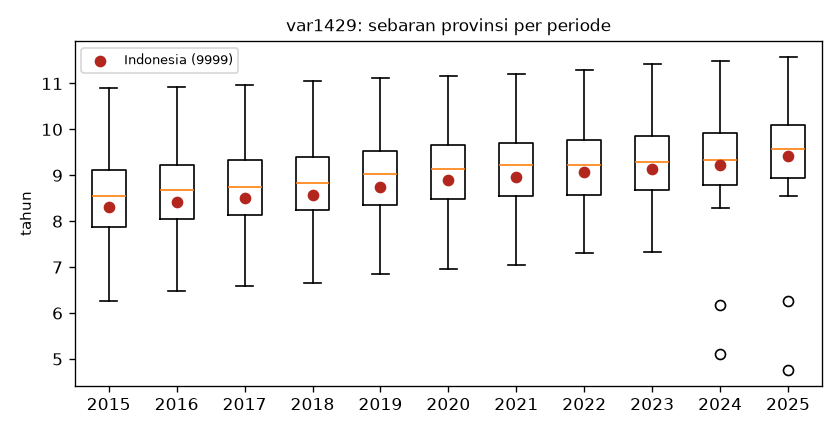
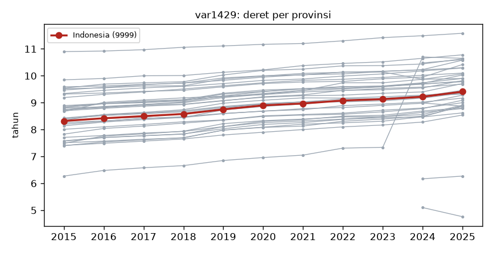
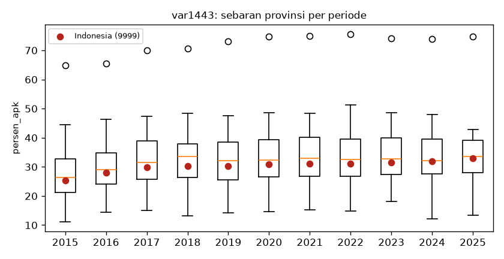
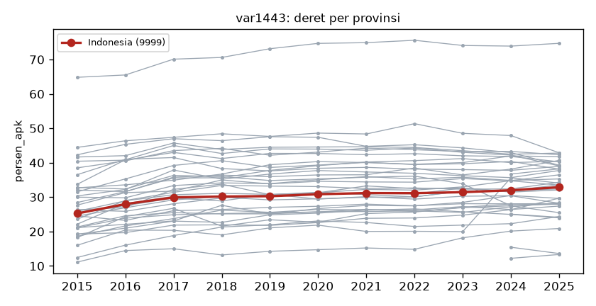
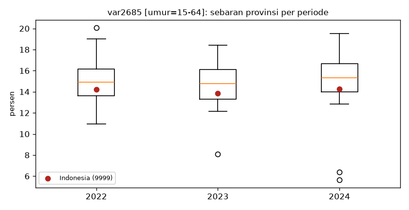
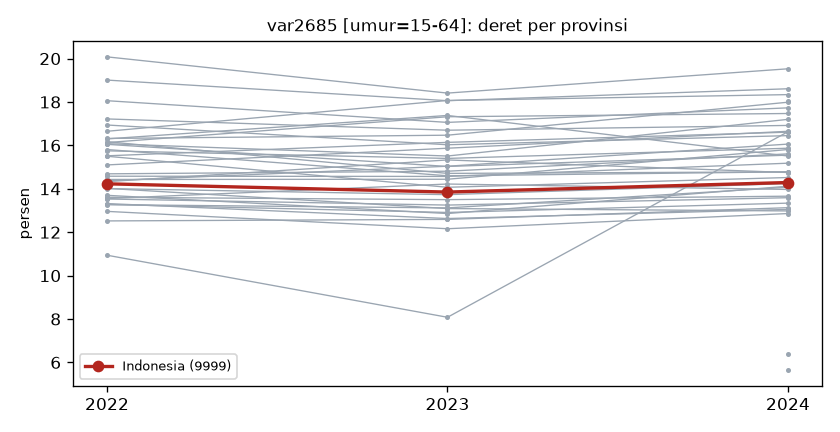
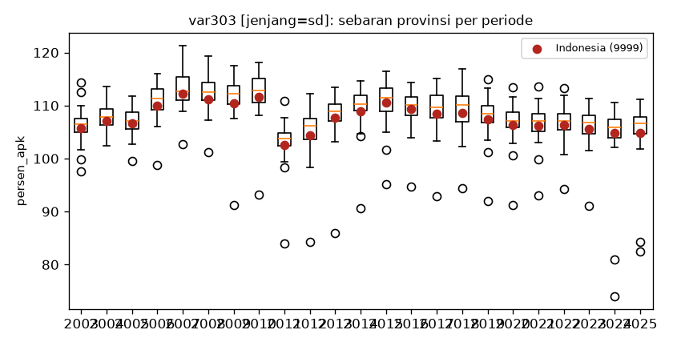
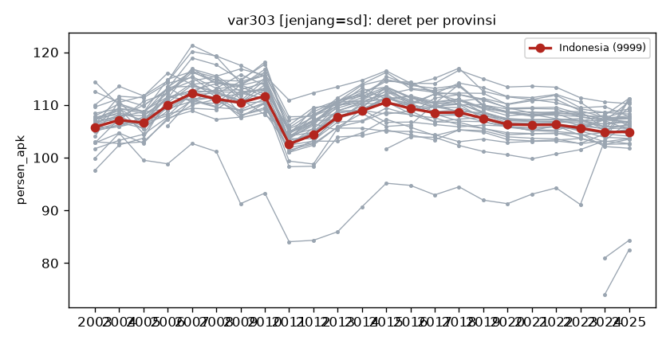
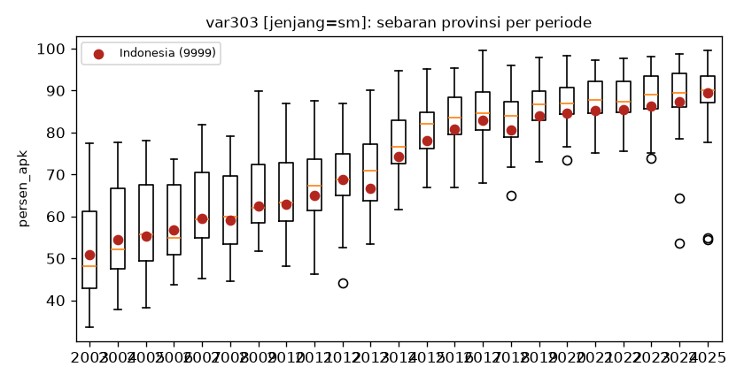
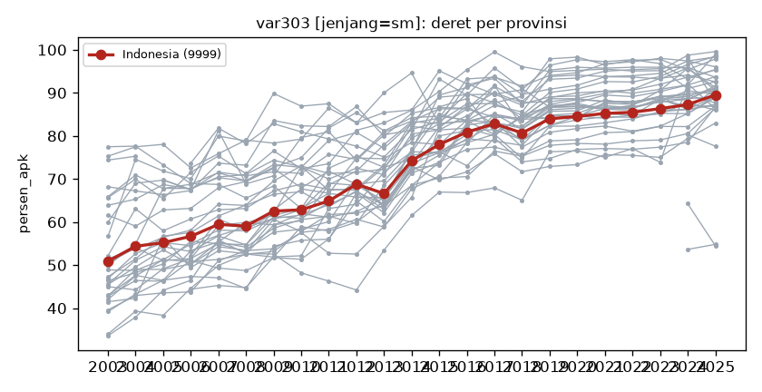
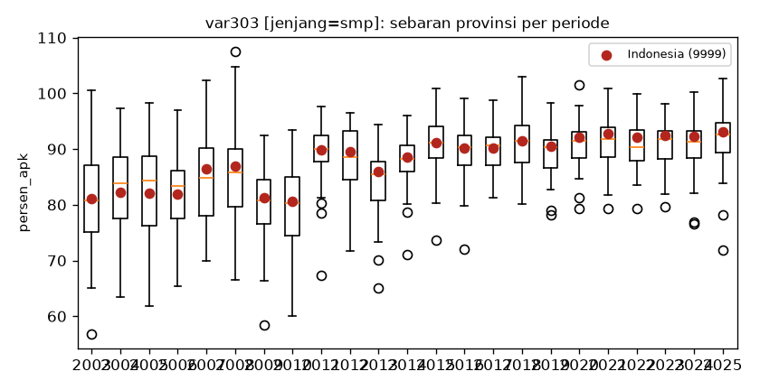
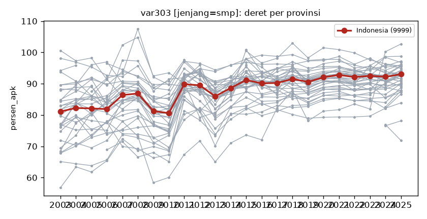
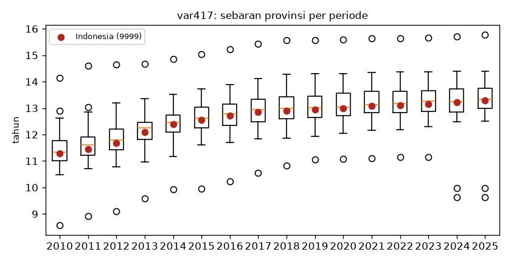
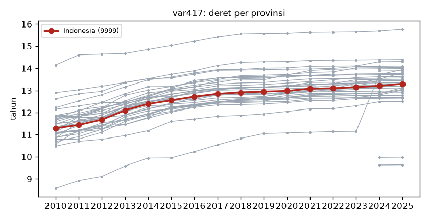
